# DeepFaceLab 4.1 · 全流程极致优化的人脸替换引擎（Windows）

[English](README_EN.md) | 中文

> 这是 **DeepFaceLab 的 PyTorch 移植版**（PyTorch port of DeepFaceLab），**兼容原版模型**：
> 可直接加载原版 `.pth` 与 `.dfm`，无需转换。
> 提取、训练、合成、导出，每一段都重做过：GPU 化、流水线并行、关键处做逐位校验。
> 界面只是外壳——没有命令行，每个页面一个主按钮，但没有一处是“只做了个界面”。
> 后端是本地 FastAPI，界面是 Web（跑在 Electron 壳里），所有推理都在本机，不联网。

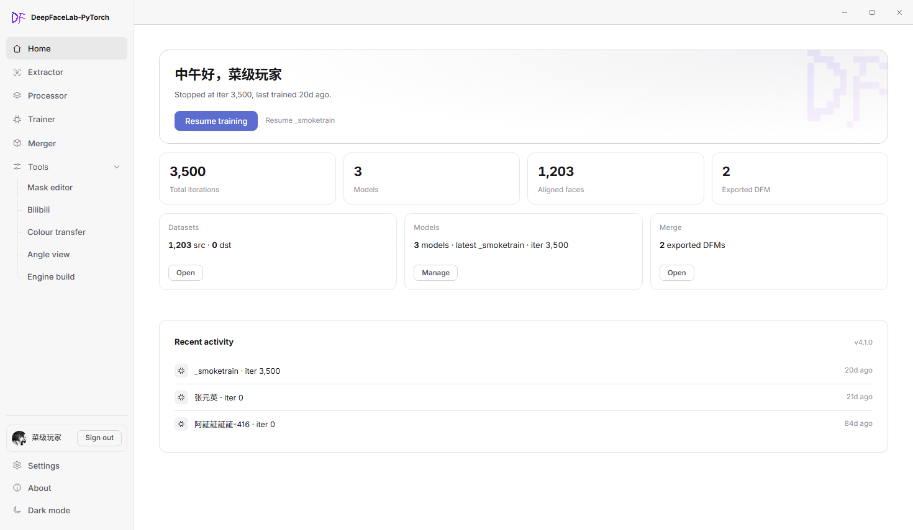

首页不是静态页：它读 `/api/state`，把「有多少帧、几个模型、训到第几轮、导出过几个 dfm」摆在你面前，
并直接把下一步做成按钮（上面这张就是「Resume training」）。

---

## 目录

- [为什么是这一版](#为什么是这一版)
- [它做什么、不做什么](#它做什么不做什么)
- [快速开始](#快速开始)
- [五个页面，一条流水线](#五个页面一条流水线)
- [工具](#工具)
- [完整工作流（照着做一遍）](#完整工作流照着做一遍)
- [注意事项（真正的坑都在这）](#注意事项真正的坑都在这)
- [性能](#性能rtx-5070-laptop-8-gb--10801920--单脸--1439-帧)
- [模型放在哪里](#模型放在哪里)
- [目录结构](#目录结构)
- [改了代码怎么验](#改了代码怎么验)
- [交流与反馈](#交流与反馈)
- [常见问题](#常见问题)

---

## 为什么是这一版

上游给了算法，这一版把整条流水线的每一段拆开重做了一遍，每条都有实测或代码可查。

| 环节 | 做了什么 | 实测 / 证据 |
|---|---|---|
| 人脸提取 | 检测、特征点、遮罩三段全部走 TensorRT + CUDA Graph，预处理搬到 GPU；遮罩支持 INT8 引擎 | 1080p 每帧约 11 ms（检测 2.98 + 特征点 0.71 + 遮罩 0.75 + 解码 3.78），2 分钟片子约 40 秒；遮罩批处理 1.658 ms/张（8 线程），比改造前快 2.2 倍 · [09-PERF](app/docs/09-PERF.md) |
| 数据处理 | 人脸库按 FDB 索引，对齐结果带门禁校验，排序、过滤、角度视图都可交互 | 3205 张样本的对齐误差 ≤ 0.0005 px · [24-ALIGN-WHOLEFACE](app/docs/24-ALIGN-WHOLEFACE.md) |
| 训练 | 优化器换 AdaBelief，收敛更稳、对学习率不敏感；CUDA Graph 与 bf16 默认开启；Inter 层可改分辨率而无需从头训 | 分辨率转换见 [38-INTER-RESIZE](app/docs/38-INTER-RESIZE.md)；dfm 走 torch bf16 + CUDA Graph |
| 合成器 | 六段并行导出，解码、检测、交换、遮罩、合成、编码各自流水；4K 多脸走逐脸 ROI 合成，不做整帧浮点累加，另有 GPU 合成路径 | 4K 三张脸：逐脸 25.5 ms，整帧浮点 116.3 ms · [14-STAGED-EXPORT](app/docs/14-STAGED-EXPORT.md)、[26-COMPOSE-GPU](app/docs/26-COMPOSE-GPU.md) |
| 交互 | 单页一步、实时预览、逐脸分配、多模型同帧、对齐前后对照，日志里写明实际生效的参数 | 见下方五个页面 |

该快的都放到 GPU 上并做了并行，该稳的地方做了逐位校验。

### 一处短板

遮罩绘制器已接入 SAM 2（Grounded SAM2 的文本点选，配合笔刷与橡皮），比上游那版完整得多。
但遮罩分割这项技术已经走到 SAM 3，本项目暂时仍停在 SAM2，在遮罩绘制的体验上还不能算与时代同步。
其余环节有实测支撑，这一项只说：比上游好，但不是最新。

---
## 它做什么、不做什么

| 做 | 不做 |
|---|---|
| 视频 → 帧 → 人脸（DFLJPG，自带对齐元数据） | 不做实时摄像头换脸 |
| 训练 SAEHD / AMP / Quick96 / XSeg | 不内置模型分发（权重自己下，见下） |
| 合成：逐帧预览、逐脸分配、多模型、人脸库 | 不做换声、口型、表情驱动 |
| 融合导出（六段并行，一条命令出片） | 不替你判断画质 —— 参数都是可见、可改的 |

**设计取向**：效果优先于速度，但**速度不许靠「静默回落」换**。
凡是「界面这么设、后端那么跑」的情况，日志和界面右下角的 `查看生效配置` 都必须喊出来。

---

## 快速开始

```bat
RunGUI.bat
```

它做三件事：拉起 Python 后端 → 读后端打印的 `PORT=` → 开窗口指向该端口。
后端默认 127.0.0.1:8760，被占用会自动顺延，窗口跟着实际端口走。

**第一次运行前**（只做一次）：

```bat
cd desktop && npm install                :: Electron 壳（node_modules 不入库）
python -m modelhub.fetch --group core    :: 必需权重，约 1.4 GB
```

只想要浏览器版（不需要任何 Electron 依赖）：

```bat
runtime\server\Scripts\python.exe app\serve.py
:: 日志里会打印 PORT=xxxx，浏览器打开 http://127.0.0.1:xxxx/
```

| 方式 | 需要什么 | 适合 |
|---|---|---|
| `RunGUI.bat` | Electron 装好 | 日常使用，无控制台窗口 |
| `app\serve.py` + 浏览器 | 只要 runtime | 调试前端 / Electron 装不上时 |
| `cd desktop && npm start` | Electron 装好 | 改外壳代码时 |

> 改界面不用重启外壳：静态资源带 mtime 版本号，刷新窗口即可。

---

## 五个页面，一条流水线

### 1 · Extractor｜视频 → 帧 → 人脸

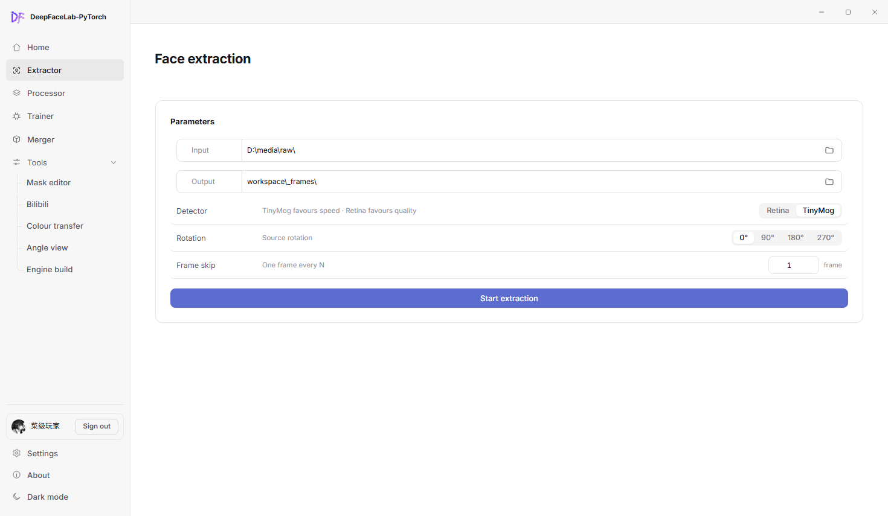

- 输入一个视频，输出 `aligned/*.jpg`（每张带 68 点与对齐矩阵，格式是 4.0 的 DFLJPG）。
- 原帧**不落盘**：ffmpeg 解一帧 → 检测 → 对齐 → 编码，三级流水线同时跑，稳态吞吐取三者最大值。
- `quality` 只决定检测器（`high`=RetinaFace，`fast`=TinyMog）；`skip` 按**源视频真实帧率**换算抽帧率，不是假设 24fps。
- 对齐闸门：5 点退化到离谱的脸默认只**记账**（`_bad_frames.txt`），不会静默丢掉 —— 想真拒就开 strict。
- 跑起来之后是六段流水线视图（解码 / 检测 / 对齐 / dfm / 遮罩 / 编码），每段一条 lane，实时读数：

  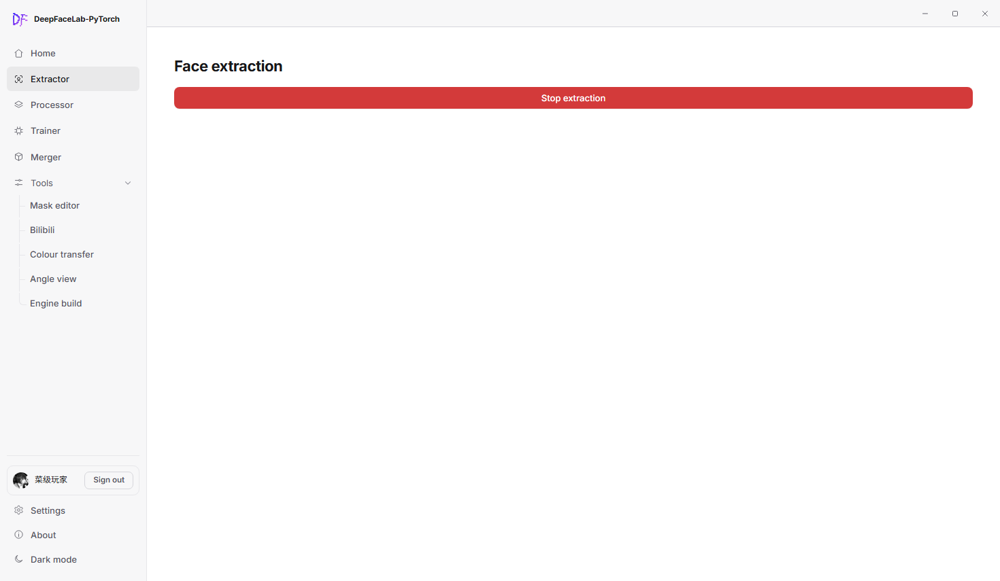

### 2 · Processor｜数据集

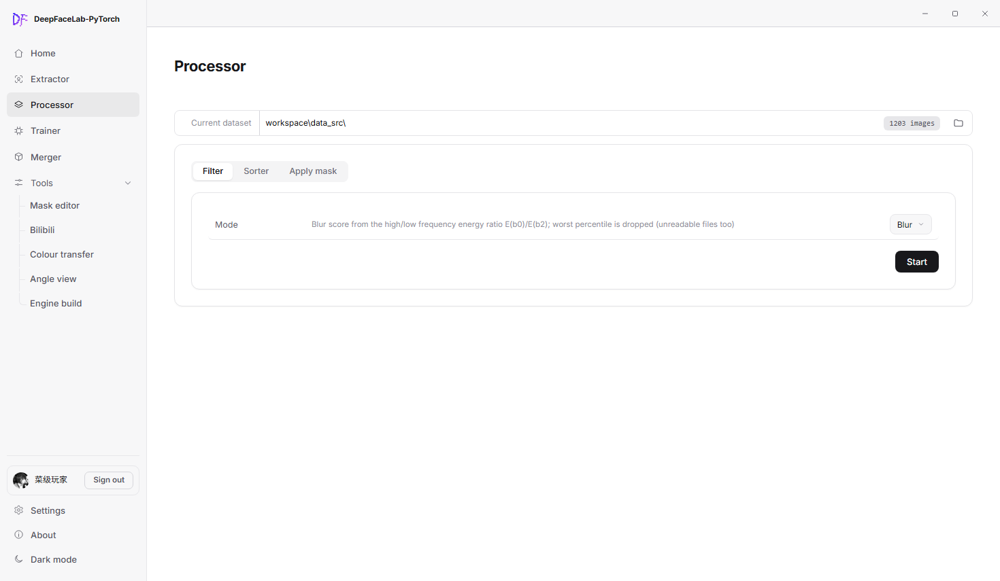

- **Filter / Sorter / Apply mask** 三件事，全部按真实数据算（清晰度、模糊度、遮挡率、dHash 去重）。
- 「这一层有几张」只认后端 `/api/dataset/count` 一个来源，界面不自己数。
- 排序器不删文件，只改顺序；过滤器才是真的筛。

### 3 · Trainer｜训练

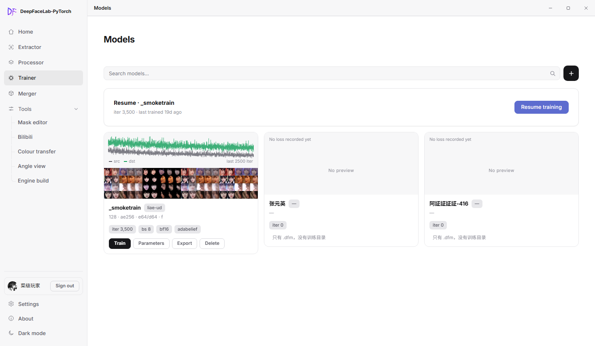

- 新建模型时给**显卡探测 + 档位推荐**，点一次直接进训练。
- 训练本体是 4.0 引擎在跑（`engine/main.py train`），界面通过 `:6789` 的预览口看实时样本。
- 参数页有搜索框（不折叠，只过滤），每项参数带一句说明（如 batch / target batch / precision），
  底部常驻「预计显存 6.1 GB」——那是按当前档位算的，不是估计值：

  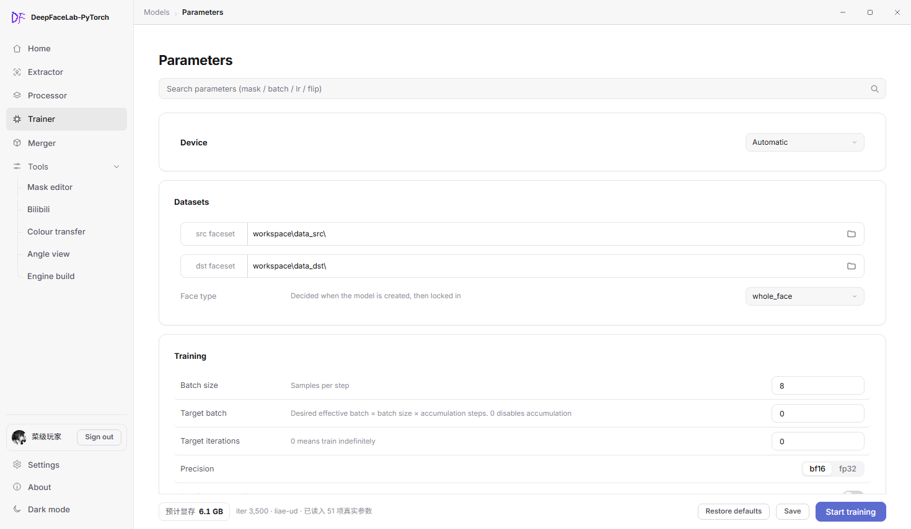

- 训练页有「继续训练」置顶卡。
- 8 GB 显存实测：128 分辨率 + batch 8，峰值 5.7 GB，约 6.5 it/s。

### 4 · Merger｜合成器

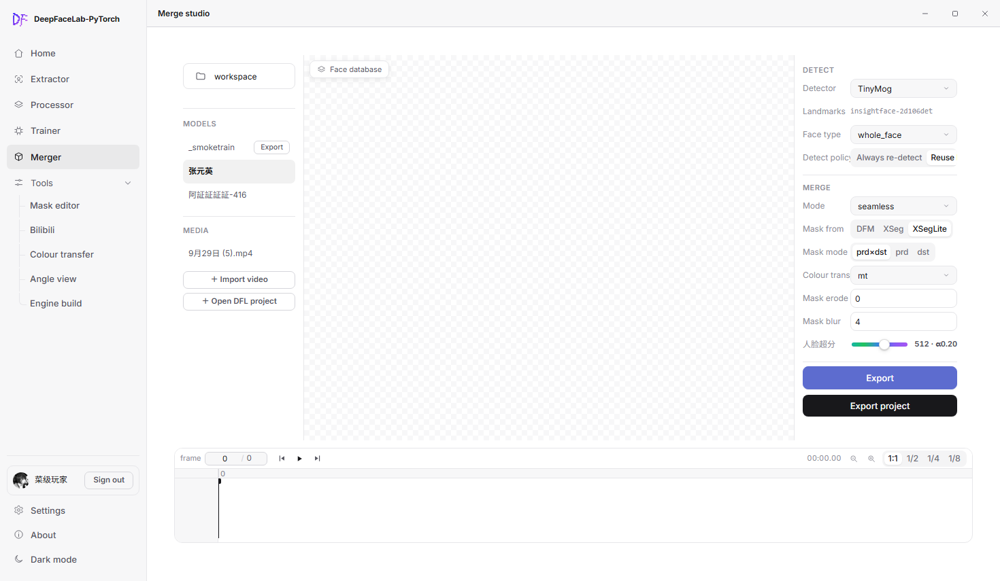

- 左：模型列表（含导出的 `.dfm`）、素材（视频或 DFL 项目）、人脸库。
- 中：逐帧预览。点画面上的脸就切「合成 / 原图」，每张脸可以**单独分配模型**。
- 右：检测档、融合方式（`overlay` / `seamless`）、遮罩来源（`DFM` / `XSeg` / `XSegLite`）、
  遮罩模式（`prd×dst` / `prd` / `dst`）、色彩迁移、腐蚀 / 羽化。
- 底部：帧号、播放、`1:1` / `1/2` / `1/4` / `1/8` 缩放。
- 两个导出按钮：**Export**（融合导出，默认）、**Export project**（4.0 项目模式，逐帧落 `merged/`）。

### 5 · Settings / About

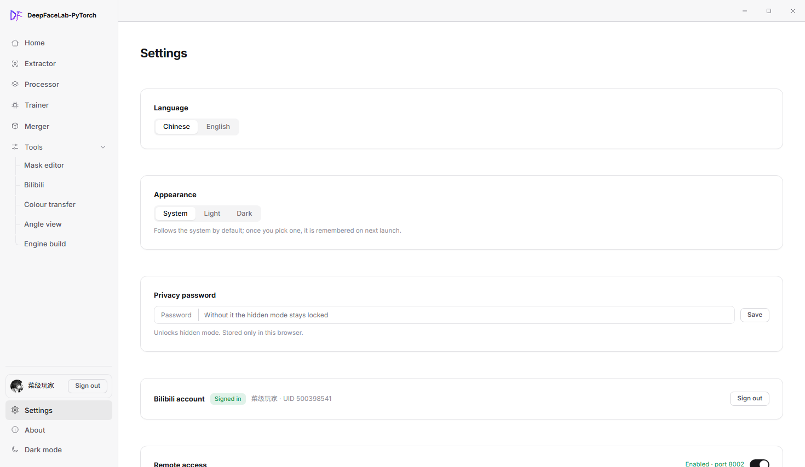

语言（中/英）、主题（浅色/深色/跟随系统）、端口、工作区路径、许可与免责声明。

About 页把「版本 / UI / 推理后端 / 已装模型 / 后端进程与端口 / 作者 / 仓库 / 许可证」一次列全，
排障时先看这一页就能确认自己跑的是哪份代码：

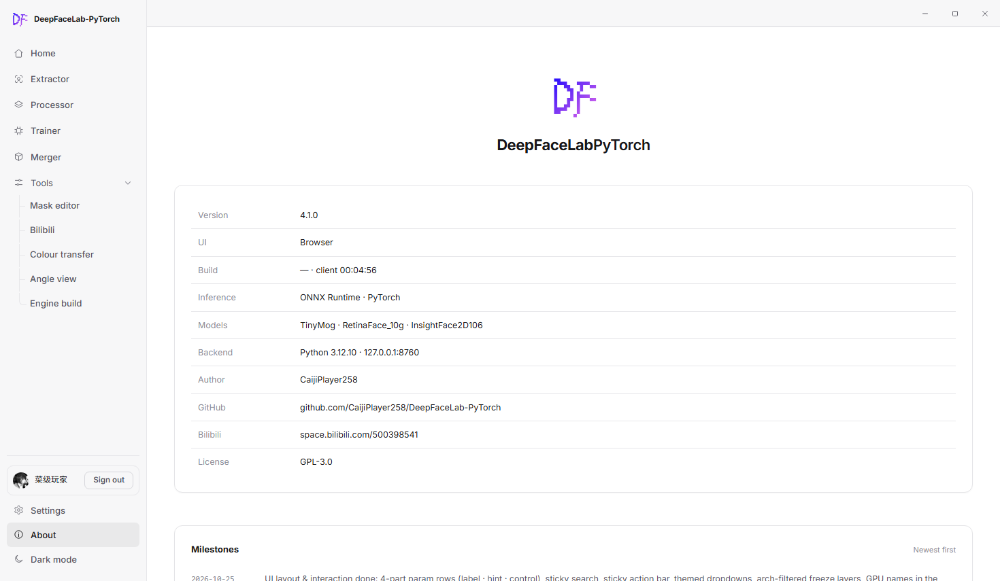

---

## 工具

| 工具 | 干什么 | 截图 |
|---|---|---|
| **Mask editor** | 逐张画遮罩：笔刷 / 橡皮 / SAM 点选 / Grounded SAM2 文本 / BiSeNet 解析 | 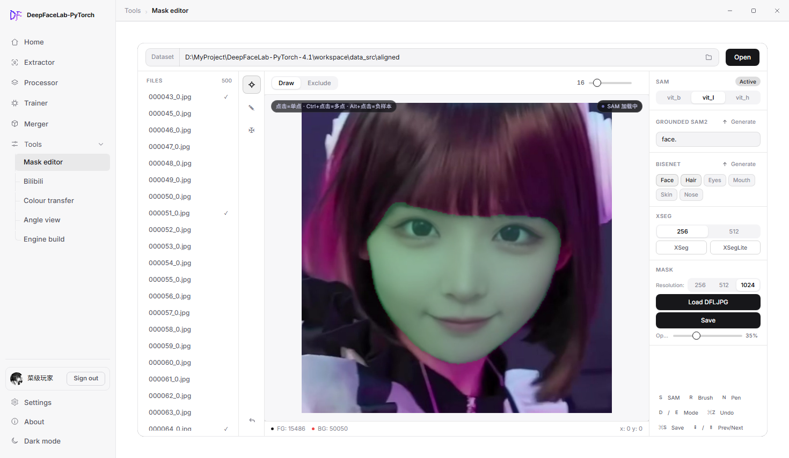 |
| **Engine build** | TensorRT 引擎的编译与状态（MD5 / 原始大小 / 引擎大小 / Ready） | 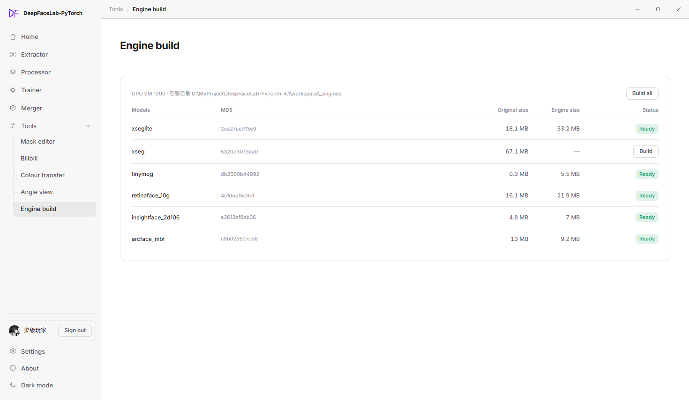 |
| **Bilibili** | 扫码登录、视频列表、下载队列（下载来的片子可直接进 Extractor） | 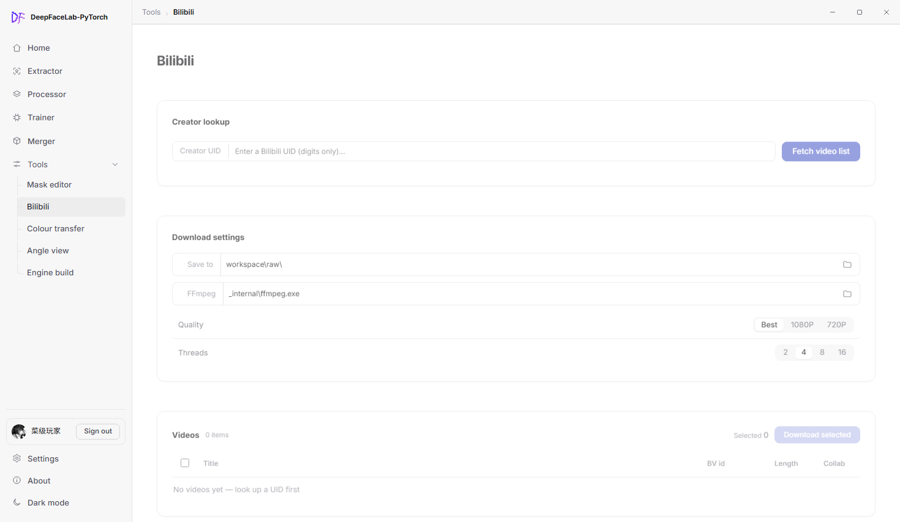 |
| **Colour transfer** | 换脸前后色调对齐的调参预览 | 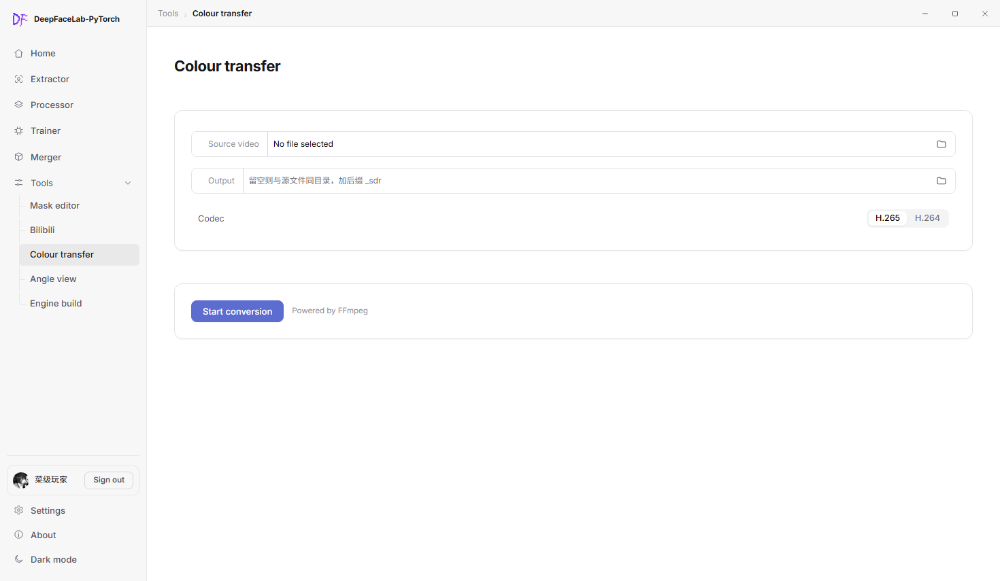 |
| **Resolution change** | 改模型分辨率：只重采样 Inter 权重，默认 `blend`（dense1 伪逆 + dense2/bias lanczos），越界给提示；[说明](app/docs/38-INTER-RESIZE.md) · [实验](app/docs/notes/inter_study/README.md) | — |
| **Angle view** | 数据集的角度分布（坐标轴 + 散点 / 格子图），900 点实时算 | 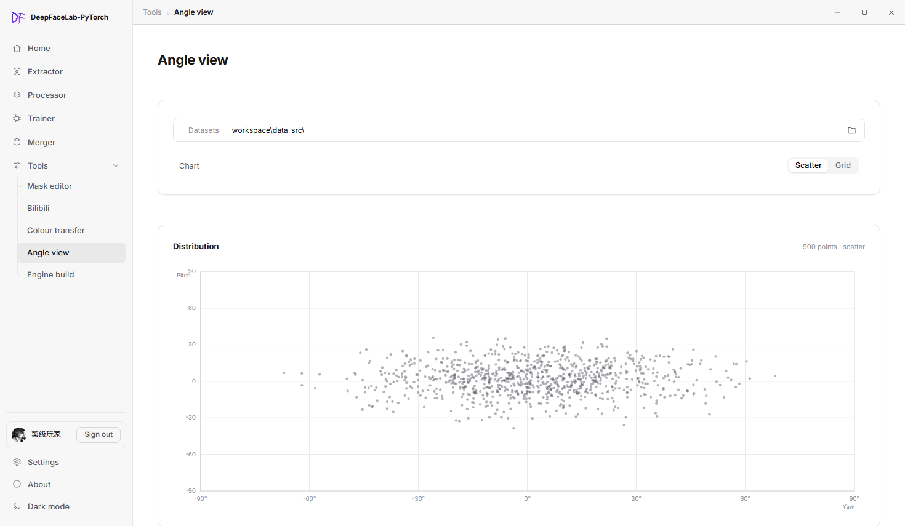 |

**Engine build 不是必需的**：没有引擎时走 onnxruntime 一样能跑；编译引擎只是把检测 / 特征点 / xseg
换成 TensorRT（本机 retinaface 12.9ms → 8.5ms）。换显卡或换 TensorRT 版本时要重编一次，平时直接加载。

---

## 完整工作流（照着做一遍）

```
① Extractor   放一段 src 视频 → 提取（得到 workspace/data_src/aligned/*.jpg）
② Extractor   放一段 dst 视频 → 提取（得到 workspace/data_dst/aligned/*.jpg）
③ Processor   对 src/dst 各跑一次 Filter（去掉糊的）+ Sorter（按清晰度/遮挡排序）
④ Trainer     新建 SAEHD（显卡推荐档位）→ 训到 loss 收敛 → 导出 .dfm
⑤ Merger      选 dst 视频 + .dfm → 逐帧看效果 → Export
```

- **src / dst 分清楚**：src 是「要换成谁的脸」，dst 是「被换的那张脸」。
- 训练至少要有 `aligned`（人脸图）；没有原帧也能训，只是合成本身需要原帧。
- 只想试效果：把别人给的 `.dfm` 丢进 `workspace/model/`，跳过 ①②④。

---

## 注意事项（真正的坑都在这）

**1. 显存 / 功耗**
   - 8 GB 卡：训练 128 分辨率 batch 8 是安全档；合成 1080p 单脸约 4.5 GB。
   - 笔记本常见功耗墙（本机 60 W / 上限 115 W）：**GPU 占用 95% 但 SM 只有 2.2 GHz 就是被功耗卡住**，
     这时优化代码没用，去调厂商性能模式或 `nvidia-smi -pl`。

**2. 模型文件（`.dfm`）**
   - 合成只认 `.dfm`；只有训练文件（`_data.dat` + `.pth`）时，先在 Trainer 里点「导出」。
   - `.dfm` 平铺在 `workspace/model/` 根下即可，不要塞子目录。

**3. 权重分包**
   - `core`（1.4 GB）**必需**：检测器、2D106、arcface、errface。
   - `sam`（3.8 GB）**可选**：SAM / Grounded SAM2 / **BiSeNet** / BERT —— 只有遮罩绘制里的扩展要用。
     不装不影响提取、训练、合成、自动遮罩（DFM / XSeg 遮罩）。

**4. 编码器与 md5**
   - 默认 `DFL_FUSED_ENCODER=auto`：有 NVENC 就用 NVENC（1080p 快 16%、4K 快 2.8 倍）。
   - **换编码器 = 成片 md5 必变**。要拿 md5 当基线，先钉 `DFL_FUSED_ENCODER=x264`。

**5. 像素对拍别拿整片 fused 比**
   - 融合导出的 dfm 是攒批跑的，批组成随时序变 → bf16 归约顺序变。
     **同一份代码跑两遍，150 帧里只有 62 帧逐位相同**（max 35 LSB）。
     要比像素用串行模式（`fused_pipeline_bench.py --modes B`），口径见 `app/docs/28-PIXEL-PARITY.md`。

**6. 对齐闸门**
   - 默认 `warn`：坏脸照样写进 `aligned/`，只记一行到 `_bad_frames.txt`。
   - 要它真拒（不写文件、计入 rejected）就设 `DFL_ALIGN_GATE=strict`，或界面里开 strict。

**7. 工作区与路径**
   - 用户数据都在 `workspace/`（数据集、模型、输出、`_engine/` 引擎缓存），**不入库**。
   - 界面里填相对路径是相对仓库根算的；带 `workspace\` 前缀的照旧指向工作区。

**8. 别同时开两个后端**
   - 同一个 `workspace` 起两个 serve.py 会抢显存与文件；`PORT=` 顺延只是避免端口冲突。

---

## 性能（RTX 5070 Laptop 8 GB · 1080×1920 · 单脸 · 1439 帧）

| 项 | 数 | 说明 |
|---|---|---|
| 融合导出 | **23.6 帧/秒** | 解码→检测→对齐→dfm→XSeg→合成→编码 全在内存里串起来 |
| GPU 段 | 32.3 ms/帧 | dfm 20.6 + xseg 9.5 + 等上游 6.8 |
| 编码 | NVENC（auto 默认） | 1080p 20.2→23.4 帧/秒；4K 17→48 帧/秒 |
| dfm | torch bf16w + CUDA Graph | 提交环 23.5→1.06 ms；b8 39.5→20.0 ms/张 |

- 默认：`DFL_DFM_BACKEND=torch`、`DFL_DFM_DTYPE=bf16w`、`DFL_DFM_GRAPH=1`、`DFL_DFM_GRAPH_U8=1`。
- **dfm 不做 fp16 / TRT**（实测没收益，还要编译）。全部开关见 [app/docs/27-ENV-KNOBS.md](app/docs/27-ENV-KNOBS.md)。
- 测试机功耗墙 60 W（硬件上限 115 W），dfm 期 SM 2.15~2.28 GHz（boost 3.09）——
  **卡在功耗不是算力**，换到 115 W 的机器这些数字会整体上移，别当通用基线。

---

## 模型放在哪里

分成两类，**别混**：

### 一、`weights/` —— 推理权重（不是用户数据）

**平铺**：所有 `.onnx / .pth / .pt / .ubj` 直接放在 `weights/` 根下，文件名 = 模型名 + 原文件名。
**这个目录里没有任何代码**，也没有按模型分的子目录（`weights/onnx/<模型>/` 那套只作兼容兜底）。
权重本身不能执行，代码可以；所以为了安全，代码一律在 `app/` 里，`weights/` 只接受权重。
用户往这里丢对应的权重，那个功能就可用了；不丢就用不了。

```
weights/
├── tinymog.onnx                 检测器（core）
├── retinaface_10g.onnx         ⬆ 同目录，平铺
├── insightface_2d106.onnx       68 点关键点
├── arcface_mbf.onnx             人脸识别 / 身份聚类
├── errface_xgb.ubj              错脸检测（core）
├── bisenet_model_final.pth      人脸解析（**sam 组**，不装 sam 就没有）
├── sam2.1_hiera_*.pt            SAM2（sam 组，四个变体平铺）
├── groundingdino_swint_ogc.pth  Grounded SAM2 的检测头
├── sam_vit_b_01ec64.pth         SAM 点击分割
└── bert-base-uncased/           ← **唯一保留的目录**：BERT tokenizer 必须和权重同目录
```

**按需下载，不用的可以不要：**

| 包 | 内容 | 大小 | 必需？ |
|---|---|---|---|
| `core` | 检测器（`retinaface_10g.onnx` / `tinymog.onnx`，另带 15 个备用检测器）、`insightface_2d106.onnx`、`arcface_*.onnx`、`errface_xgb.ubj` 等 40 个文件 | ~1.4 GB | ✅ 必需 |
| `sam` | 遮罩绘制的交互分割：`sam_vit_b_01ec64.pth` / `sam2.1_hiera_*.pt` / `groundingdino_*.pth` / `bert-base-uncased/` / **`bisenet_model_final.pth`** | **~3.8 GB** | ❌ 可选 |

不装 SAM 那一组会怎样：**提取、训练、合成、自动遮罩全部照常**，
只有「工具 → 遮罩绘制」里 SAM / Grounded SAM2 / BiSeNet 三块是灰的。
只想要"检测 + 换脸"的用户完全不需要它。

下载方式：

```bat
python -m modelhub.fetch --group core     :: 必需（检测器、特征点、识别、XSeg）
python -m modelhub.fetch --group sam      :: 可选（遮罩绘制扩展，约 3.4 GB）
```

清单与校验值见 [weights/manifest.json](weights/manifest.json)，其中 `packages` 段说明了每个包解锁哪些功能；
`path` 字段就是平铺文件名（唯一带目录的是 `bert-base-uncased/`）。
想放到别的盘，用环境变量 `DFL_WEIGHTS_DIR` 指向新的根目录（布局仍然是平铺；
指向老的分目录布局也能用，`modelhub/weights.py` 的 `LEGACY_LAYOUT` 兜底）。

### 二、`workspace/model/` —— 你自己的模型

**布局规则（两条，别混）：**

```
workspace/model/
├─ 我的模型_SAEHD_data.dat        ← 换脸模型：直接平铺在根下
├─ 我的模型_SAEHD_encoder.pth
├─ 我的模型_SAEHD_decoder.pth
├─ 我的模型.dfm                   ← 合成用的导出件（平铺）
├─ XSegLite/                      ← 可训练的遮罩模型：各自一个子目录
│  ├─ XSegLite.onnx
│  └─ …
└─ XSeg/
   └─ XSeg.onnx
```

- **换脸模型（SAEHD / AMP / Quick96）**：文件平铺，一组 `_data.dat` + `.pth`，外加可选的 `.dfm`
- **可训练的遮罩模型（XSeg / XSegLite）**：一个模型一个文件夹，和换脸模型分开
- **合成只认 `.dfm`**：只有训练文件没有 `.dfm` 时，先在训练器里点「导出」
- 别人给你的、只有 `.dfm` 没有训练目录的模型，直接丢进根下即可，合成器会列出来

### 不放模型的地方

- `app/`、`desktop/` —— 代码目录
- 仓库根目录 —— 会让 `git status` 变脏（`workspace/`、`weights/` 已忽略）

---

## 目录结构

```
desktop/          Electron 外壳
app/
├─ serve.py       FastAPI 入口（打印 PORT=，外壳读它）
├─ server/        后端，一个界面一个包（backend_extract / backend_merge / backend_train …）
│                 加 _common / _media / _vision 三个公共层；app.py 只有 ~300 行组装
├─ web/           前端（原生 JS + CSS，无构建步骤）
│                 js/app/ 下是 23 个分片，后端按顺序拼成 /static/js/app.js
├─ engine/        4.0 引擎（vendored：训练 / 合成管线 / modelhub）
├─ tools/         accept（验收）· bench（台架）· audit（协议对账）· shots（README 截图）
└─ docs/          00~35 编号文档 + notes/ 实验记录 + legacy-reference/ 归档
weights/          推理权重（平铺）—— 不入库
workspace/        数据集 / 模型 / 输出 / 引擎缓存 —— 不入库
runtime/          两个 venv（server 跑后端、engine 跑训练/合成）—— 不入库
```

细节见 [app/docs/04-ACTUAL-STRUCTURE.md](app/docs/04-ACTUAL-STRUCTURE.md)。

---

## 改了代码怎么验

```bat
:: 1. 语法 / 导入
runtime\server\Scripts\python.exe -m compileall -q app\server
runtime\server\Scripts\python.exe -c "import sys;sys.path.insert(0,'app');import server.app"
node app\tools\js\check_bundle.js              :: 前端分片拼接后是否仍是合法 JS

:: 2. 验收（真跑；按改动挑）
runtime\server\Scripts\python.exe app\tools\accept\fused_export_accept.py              :: 融合导出 67 项
runtime\server\Scripts\python.exe app\tools\accept\stage6_accept.py                   :: 六阶段 64 项
runtime\server\Scripts\python.exe app\tools\accept\progress_lit_accept.py --shots-only :: 进度页 79 项
runtime\server\Scripts\python.exe app\tools\accept\merge_ui_accept.py                :: 合成器界面 33 项
runtime\server\Scripts\python.exe app\tools\audit\api_contract_audit.py               :: 前后端协议对账

:: 3. 像素与性能基线（改动合成/推理时）
runtime\server\Scripts\python.exe app\tools\bench\fused_pipeline_bench.py --frames 30 --modes B
::   30 个 PNG 的 md5 必须与 app/docs/notes/fused-baseline-hashes.txt 逐行相同

:: 4. 重拍 README 截图（改了界面时）
runtime\server\Scripts\python.exe app\tools\shots\readme_shots.py
```

---

## 常见问题

**Q：启动后白屏 / 一直「正在连接」？**
A：先看后端是否真的起来了（控制台有没有 `PORT=`）；浏览器版直接用那个端口访问，Electron 版看 `desktop` 是否 `npm install` 过。

**Q：训练页没有实时预览？**
A：预览走引擎自带的 `:6789`，被防火墙拦或端口占用时会空着；训练本身不受影响。

**Q：合成时某个脸换了模型没生效？**
A：点右下角 `查看生效配置`，里面有「模型 / 人脸库 / 帧范围 / 推理精度」等 14 个字段的真实取值与来源（界面 / 推断 / 默认）。

**Q：导出报「显存不够」？**
A：提示里会写「需要 X GB / 可用 Y GB」并给建议档位；可以点「仍然尝试」按最小档真跑（真 OOM 会自动回滚）。

**Q：换了显卡，第一次导出特别慢？**
A：在编 TensorRT 引擎（一次性）。也可以先去 Tools → Engine build 手动编。

**Q：`weights/` 里文件都在，检测还是没有？**
A：文件名必须与 `weights/manifest.json` 的 `path` 完全一致（平铺，不是子目录）；缺什么会直接报出该执行的下载命令。

---

## 常见问题与关键词

**这是什么？** 一个 Windows 上开箱可用的人脸替换流水线：提取、训练、合成、导出，每段都做过工程优化。

**和 DeepFaceLab 什么关系？** 算法源自 DeepFaceLab，本仓库把执行链路重写（GPU 化、并行、逐位校验），并加了图形界面。

**支持哪些显卡？** CUDA 显卡即可；TensorRT 引擎可选，不装也能跑（onnxruntime 兜底）。8 GB 显存可训练 128 分辨率。

**能改模型分辨率吗？** 能，用 `resize_inter`（默认方法 `blend`），不必从头训；投产前仍需短续训。

**关键词**：deepfake、face swap、换脸、DeepFaceLab 替代、PyTorch、TensorRT、CUDA、Windows、图形界面、一键合成、视频换脸。

## 交流与反馈

本项目目前处于高活跃状态：提取、训练、合成三条线都在持续迭代，问题修复与新功能落地都比较快。

| 渠道 | 用途 |
|---|---|
| [GitHub Issues](https://github.com/CaijiPlayer258/DeepFaceLab-PyTorch/issues) | 报 bug、提需求、贴日志与复现步骤，推荐（可搜索、可追溯） |
| QQ 群：191017993 | 使用问题、环境配置、训练调参，以及不确定该不该开 issue 的问题 |
| Bilibili：https://space.bilibili.com/500398541 | 版本演示与更新说明 |

反馈时附上版本号（关于页可见）、出问题的页面（提取 / 训练 / 合成）、
workspace/logs 里对应的日志尾部，以及能复现的输入（一小段视频或几张图即可），响应会明显更快。

---
## 协议

GPL-3.0
