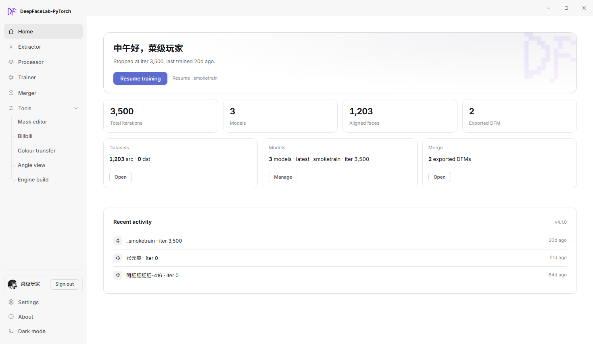
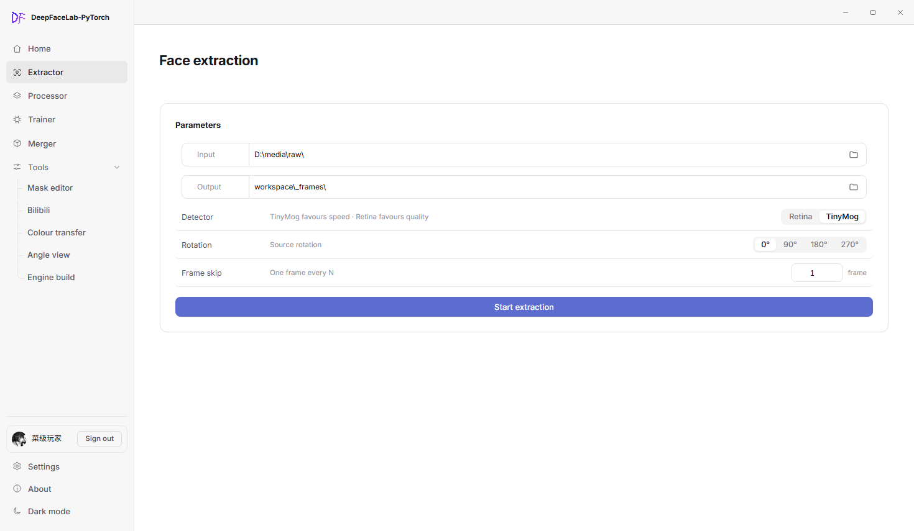
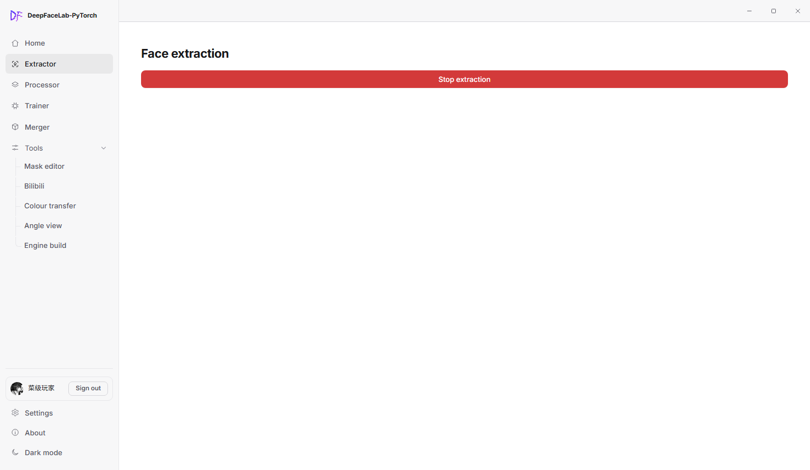
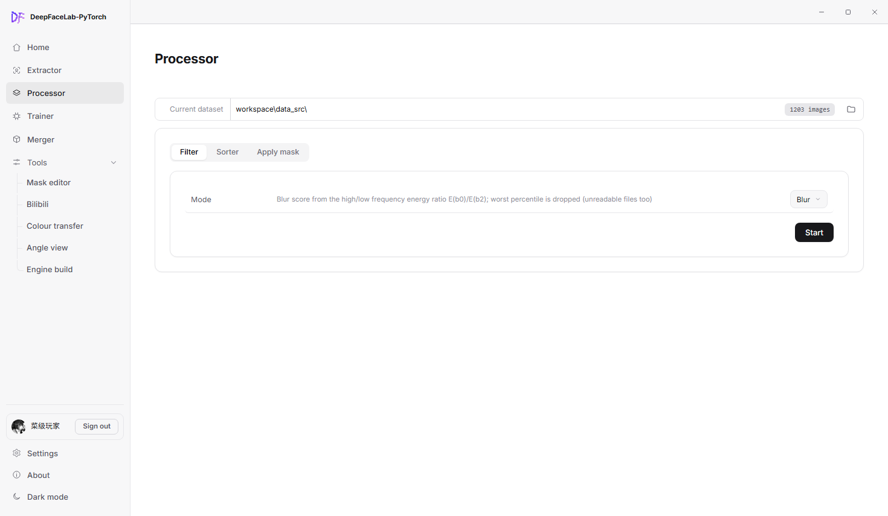
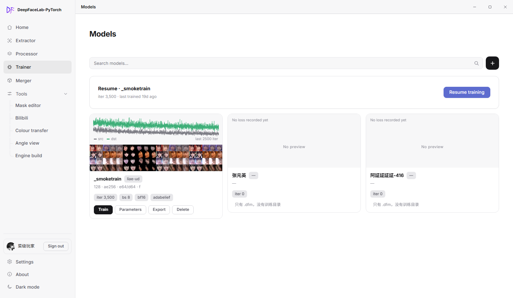
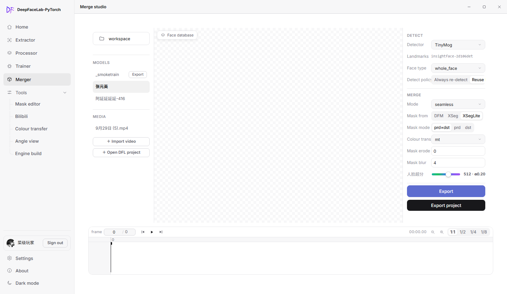
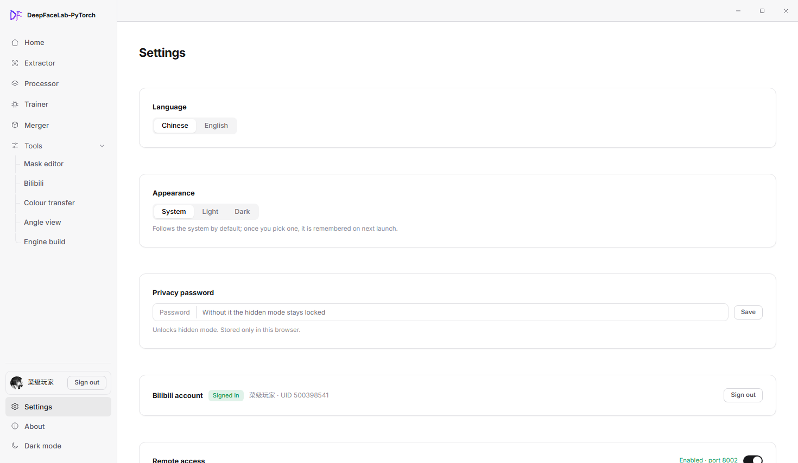

# DeepFaceLab 4.1 · A face-swap pipeline optimised end to end (Windows)

English | [中文](README.md)

> Extraction, training, merging and export were each rebuilt: GPU paths, pipelined stages, bit-exact checks where
> correctness matters. The UI is only the shell — no command line, one primary button per page, but nothing here is
> a UI with the engine left untouched. The backend is a local FastAPI service and every inference runs on your machine.



The home page is not static: it reads `/api/state` and shows how many frames, how many models, which iteration,
and how many `.dfm` have been exported, then turns the next step into a button.

---

## Why this fork

Upstream provided the algorithms. This fork rebuilt every stage of the pipeline, and each claim below has a
measurement or a code path behind it.

| Stage | What was done | Measured / evidence |
|---|---|---|
| Face extraction | Detection, landmarks and mask all run through TensorRT with CUDA Graph, preprocessing moved to GPU, INT8 engine for the mask | ~11 ms per 1080p frame (detect 2.98 + landmarks 0.71 + mask 0.75 + decode 3.78), ~40 s for a 2-minute clip; mask batch pass 1.658 ms/frame at 8 threads, 2.2x faster than before · [09-PERF](app/docs/09-PERF.md) |
| Data handling | Face database indexed by FDB, alignment gated by a bit-exact check, sorting / filtering / angle view all interactive | Alignment error ≤ 0.0005 px over 3205 samples · [24-ALIGN-WHOLEFACE](app/docs/24-ALIGN-WHOLEFACE.md) |
| Training | AdaBelief optimizer, CUDA Graph and bf16 on by default, Inter weights can change resolution without retraining | see [38-INTER-RESIZE](app/docs/38-INTER-RESIZE.md); dfm path runs torch bf16 + CUDA Graph |
| Merger | Six-stage parallel export (decode, detect, swap, mask, compose, encode), per-face ROI compositing for multi-face 4K instead of whole-frame float accumulation, plus a GPU compose path | 4K with three faces: 25.5 ms per-face ROI vs 116.3 ms whole-frame float · [14-STAGED-EXPORT](app/docs/14-STAGED-EXPORT.md), [26-COMPOSE-GPU](app/docs/26-COMPOSE-GPU.md) |
| Interaction | One step per page, live preview, per-face model assignment, multi-model frames, before/after alignment, logs that state the parameters actually in effect | see the five pages below |

The fast paths run on GPU and in parallel; the parts that must stay exact are verified bit-exactly.

### One known gap

The mask editor is wired to **SAM 2** (Grounded SAM2 text prompts plus brush and eraser), which is well beyond
what upstream offered. Mask segmentation itself has moved on to **SAM 3**, and this fork still runs SAM 2, so the
mask-drawing experience is not yet current. Everything else above has measurements; this item is honestly
"better than upstream, but not the newest".

---

## What it does and does not do

| Does | Does not |
|---|---|
| video → frames → faces (DFLJPG with alignment metadata) | real-time webcam swapping |
| train SAEHD / AMP / Quick96 / XSeg | ship pretrained models (fetch them, see below) |
| merge: frame preview, per-face assignment, multiple models, face library | voice, lip-sync or expression driving |
| staged export: six parallel stages, one command to a finished video | judge quality for you — every parameter is visible and editable |

---

## Quick start

```bat
RunGUI.bat
```

One-time setup:

```bat
cd desktop && npm install                :: Electron shell (node_modules is not in the repo)
python -m modelhub.fetch --group core     :: required weights, about 1.4 GB
```

Browser-only mode, no Electron needed:

```bat
runtime\server\Scripts\python.exe app\serve.py
:: the log prints PORT=xxxx, open http://127.0.0.1:xxxx/
```

| Mode | Requires | Good for |
|---|---|---|
| `RunGUI.bat` | Electron installed | daily use, no console window |
| `app\serve.py` + browser | only the runtime | front-end work, or when Electron cannot install |
| `cd desktop && npm start` | Electron installed | changing the shell itself |

UI edits need no restart: static assets are versioned by mtime, just refresh.

---

## Five pages, one pipeline

### 1 · Extractor — video to frames to faces



- Input a video, get `aligned/*.jpg` with 68 landmarks and the alignment matrix (4.0 DFLJPG format).
- Source frames never touch the disk: ffmpeg decode → detect → align → encode run as a three-stage pipeline,
  so steady-state throughput is the slowest stage.
- `quality` only selects the detector (`high` = RetinaFace, `fast` = TinyMog); `skip` is computed from the real
  source frame rate rather than assuming 24 fps.
- Alignment gate: badly degenerate faces are logged to `_bad_frames.txt` instead of being dropped silently;
  enable strict mode to actually reject them.



### 2 · Processor — the dataset



Filter, sorter and mask application all work on real data (sharpness, blur, occlusion ratio, dHash de-duplication).
The counts shown come from a single source, `/api/dataset/count`. The sorter never deletes files, it only reorders.

### 3 · Trainer



- New models get GPU probing and a recommended preset; one click starts training.
- Training runs on the 4.0 engine (`engine/main.py train`); the UI watches live samples through port `:6789`.
- The parameter page has a filter box and one line of explanation per parameter; the footer shows the projected
  VRAM for the current preset instead of a guess.
- Measured on 8 GB: resolution 128, batch 8, peak 5.7 GB, about 6.5 it/s.

### 4 · Merger



- Left: models (including exported `.dfm`), source video or DFL project, face library.
- Centre: frame-by-frame preview; click a face to toggle swap/original, and assign a model per face.
- Right: detector level, blend mode (`overlay` / `seamless`), mask source (`DFM` / `XSeg` / `XSegLite`),
  mask mode (`prd×dst` / `prd` / `dst`), colour transfer, erode and feather.
- Two exports: **Export** (fused, default) and **Export project** (4.0 project layout writing `merged/`).

### 5 · Settings / About



Language, theme, port, workspace path, licence. The About page lists version, UI build, inference backend,
installed models, backend process and port, author, repository and licence — the first place to look when
reporting a problem.

---

## Workflow

```
1 Extractor   src video  -> workspace/data_src/aligned/*.jpg
2 Extractor   dst video  -> workspace/data_dst/aligned/*.jpg
3 Processor   filter + sort both datasets
4 Trainer     new SAEHD model -> train -> export .dfm
5 Merger      pick dst video and .dfm -> preview -> Export
```

src is the face you want, dst is the face being replaced. A `.dfm` dropped into `workspace/model/` lets you skip
steps 1, 2 and 4 if you only want to see the merger.

---

## Notes worth reading

- **No silent fallbacks.** If the UI sets one thing and the backend runs another, both the log and the
  `查看生效配置` panel say so.
- **TensorRT is optional.** Without engines the code falls back to onnxruntime; building engines only makes
  detection and landmarks faster (retinaface 12.9 ms → 8.5 ms on this machine).
- **8 GB cards.** Resolution 128 with batch 8 is the safe training preset; 1080p single-face merge peaks around 4.5 GB.
- **Model resolution is changeable.** Use the resize tool (default method `blend`) rather than retraining from
  scratch; retraining is still required before the model is used in production.

---

## Performance (RTX 5070 Laptop 8 GB, 1080×1920, single face, 1439 frames)

See [09-PERF](app/docs/09-PERF.md) for the full table. Highlights: 1080p extraction ~11 ms/frame;
mask batch pass 1.658 ms/frame; 4K three-face compose 25.5 ms with per-face ROI.

---

## Where models live

```
workspace/
  model/        trained models (*.pth, *.dfm) and their .dat sidecars
  data_src/     aligned faces of the source person
  data_dst/     aligned faces of the target video
  _engines/     compiled TensorRT engines
```

---

## FAQ and keywords

**What is this?** A Windows face-swap pipeline you can run out of the box: extraction, training, merging and export,
with each stage re-engineered rather than wrapped.

**How does it relate to DeepFaceLab?** The algorithms come from DeepFaceLab; this repository rewrites the execution
path (GPU, pipelining, bit-exact checks) and adds a GUI.

**Which GPUs?** Any CUDA card. TensorRT engines are optional (onnxruntime fallback). 8 GB is enough for resolution
128 training and 1080p single-face merging.

**Can the model resolution change?** Yes, with `resize_inter` (default method `blend`); a short fine-tune is still
needed before production use.

**Keywords**: deepfake, face swap, DeepFaceLab alternative, PyTorch, TensorRT, CUDA, Windows GUI, video face swap,
one-click merge, face extraction, SAEHD.

## Feedback

This project is under **active development**: extraction, training and merger are all being iterated on, and
fixes and features land quickly.

| Channel | Use it for |
|---|---|
| [GitHub Issues](https://github.com/CaijiPlayer258/DeepFaceLab-PyTorch/issues) | bugs, feature requests, logs and reproduction steps (searchable, traceable) |
| QQ group: 191017993 | usage questions, environment setup, training knobs, or anything you are unsure deserves an issue |
| Bilibili: https://space.bilibili.com/500398541 | version demos and change notes |

Include the version (About page), the page that failed (extract / train / merge), the tail of the matching log in
`workspace/logs`, and a minimal input (a short clip or a few images) if you can — it makes the response much faster.

---

## Licence

GPL-3.0, see [LICENSE](LICENSE). Upstream project: [iperov/DeepFaceLab](https://github.com/iperov/DeepFaceLab).
Modules and algorithms added in this repository, including Inter cross-resolution resampling,
are independently designed and implemented here.