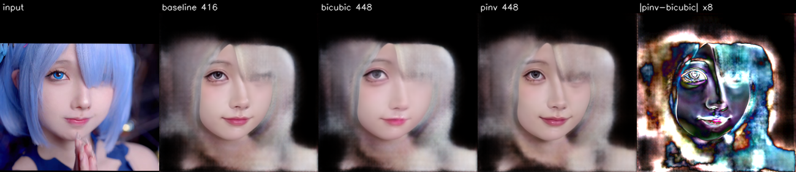
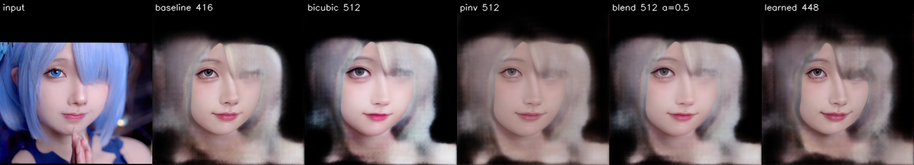
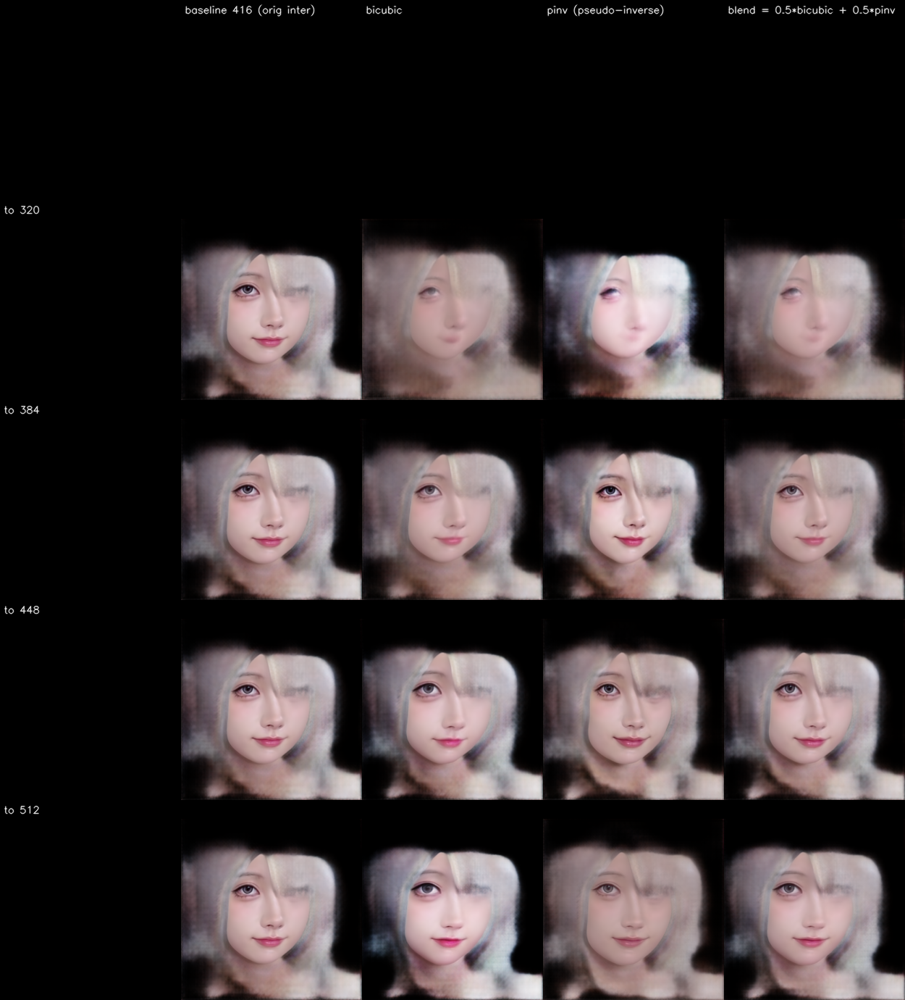

# Inter 权重换分辨率实验（df-udt @ 416）

模型：workspace/model/New416_SAEHD（df-udt, 416, e_dims=80, ae_dims=320）。素材：app/docs/notes/target.jpg（已对齐）。
前向：仓库自带 leras（DeepFakeArchi, opts=udt）；预处理 BGR + [0,1]；
**所有指标都在 XSegLite 遮罩内统计**（workspace/model/XSegLite/xseglite.onnx，256×256 NCHW）。

## 1. 为什么 bicubic 视觉上更好

把 dense1 的权重看成一张 C×n×n 的“图”，换分辨率就是对它重采样。各核的频响：

| 核 | 频响 | 结果 |
|---|---|---|
| nearest | 常数（=保持） | 频谱镜像混叠，块状 |
| bilinear | sinc²，通带掉得厉害（Nyquist 附近约 -4 dB） | 权重被抹平，人脸发糊 |
| bicubic (Catmull-Rom, a=-0.5) | 通带更平，-1 dB 量级 | 细节保得住，且可分离、代价低 |
| area | 盒式平均 | 只在降采样时等价于抗混叠，升采样时过平 |

权重里高频是“身份细节”，所以**谁的通带平，谁就更像原模型** —— 这就是 bicubic 视觉上赢的原因，
不是玄学。它的代价是负瓣带来的振铃（overshoot），但在权重空间只表现为轻微对比过冲，
经 sigmoid 输出后几乎不可见。

## 2. 但插值本身不是最优（数学）

要保的是泛函 ⟨W, f⟩。换分辨率后 f' ≈ (L⊗L)f，于是需要

    (L⊗L)ᵀ W' = W          … (1)

- **升分辨率**（m>n）：(1) 欠定 → 最小范数解 W' = (L⊗L)[(L⊗L)ᵀ(L⊗L)]⁻¹ W 
- **降分辨率**（m<n）：(1) 超定 → 最小二乘解 W' = [(L⊗L)(L⊗L)ᵀ]⁻¹(L⊗L) W

插值给的是 (L⊗L)W，**缺了那一步逆滤波**（它相当于把权重先锐化一次再做插值）。
逆滤波在高频会放大噪声，所以加 Tikhonov：升用 (LᵀL+λI)⁻¹，降用 (LLᵀ+λI)⁻¹。
这就是我说的 **pinv 方法**：`app/tools/bench/inter_adv.py`。

## 3. 遮罩内结果（XSegLite，416 输出为基准）

| 目标 | 方法 | PSNR | SSIM | MAE | 潜码 cos |
|---|---|---|---|---|---|
| 320 | nearest | 18.77 | 0.749 | 23.89 | 0.622 |
| 320 | bilinear | 19.11 | 0.745 | 23.29 | 0.747 |
| 320 | **bicubic** | **19.32** | 0.740 | 23.06 | 0.779 |
| 320 | area | 18.83 | 0.736 | 23.51 | 0.748 |
| 320 | pinv λ=0.1 | 19.31 | 0.715 | **16.96** | **0.789** |
| 384 | bicubic | 23.32 | 0.813 | 13.37 | 0.906 |
| 384 | **pinv λ=0.1** | **24.12** | **0.866** | **11.97** | **0.939** |
| 384 | pinv λ=0.01 | 23.19 | 0.849 | 11.82 | 0.941 |
| 448 | bicubic | 23.41 | 0.834 | **8.80** | 0.939 |
| 448 | **pinv λ=1e-4** | **24.98** | 0.872 | 9.21 | **0.962** |
| 448 | pinv λ=0.01 | 24.77 | **0.875** | 10.13 | 0.963 |
| 512 | bicubic | 20.26 | 0.814 | **18.78** | 0.915 |
| 512 | **pinv λ=1e-4** | **21.19** | **0.837** | 19.00 | **0.931** |

**pinv 在升分辨率（384/448/512）全面超过 bicubic**：PSNR +0.8~1.6 dB、SSIM +0.02~0.05、
潜码余弦 +0.02~0.03，代价是 MAE 略高（高频更锐，逐像素差略增）。
320（降分辨率）时 bicubic 的 PSNR 更高，但 pinv λ=0.1 的 MAE 与潜码余弦更好；
降采样本来就不可逆，这里两种方法都只是热启动。

### 3.1 数据驱动修正：负结果

我还试了用真实激活做最小二乘修正（对偶岭回归，96 帧视频特征，见 inter_adv.py:ls_correct）：

| 目标 | bicubic | ls 修正后 |
|---|---|---|
| 384 | 23.32 / 0.813 / cos 0.906 | 19.61 / 0.730 / cos 0.785 |
| 448 | 23.41 / 0.834 / cos 0.939 | 22.36 / 0.809 / cos 0.817 |
| 512 | 20.26 / 0.814 / cos 0.915 | 14.02 / 0.755 / cos 0.541 |

**反而更差**。原因：F'（新分辨率的真实特征）与 W 之间不存在严格的线性对应，
回归把“图像内容差异”也拟合进去了；96 个样本对 C·m² 维（16k~164k）来说太少，
λ 稍小就过拟合。要它有用，得用上万张脸 + 强正则，成本远超收益。记录在此，避免重复踩。

## 4. 结论与建议

1. 视觉上 **bicubic 明显好于 bilinear/nearest**（通带更平）；这条被数据确认。
2. 但**更好的选择是 pinv**（保泛函的伪逆重采样）：升分辨率 λ≈1e-4~1e-2，降分辨率 λ≈0.1。
   384/448/512 上 PSNR、SSIM、潜码余弦全面优于 bicubic。
3. 数据驱动的 LS 修正目前是负结果，不要用。
4. 所有方法都只是热启动；换完分辨率仍需续训（优化器状态形状不兼容会被删）。

## 5. 复现

     runtime\engine\python.exe app/tools/bench/inter_adv_study.py     # 遮罩内 48 组对比（含 pinv / ls）
     runtime\engine\python.exe app/tools/bench/inter_study_run.py     # 原始 16 组（bilinear 系列）
     python app/tools/bench/inter_resample.py --src <inter.pth> --res 416 --to 448 --method bicubic --out <out.pth>

实现：app/tools/bench/inter_adv.py（插值矩阵 L、pinv、ls_correct）、xseg_mask.py（遮罩内指标）。
数据：results_adv.json（48 组）、results.json（16 组）、latent_metrics.json。
## 6. 再进一步：混合解（本报告最推荐的算法）

定义先说清楚：**blend = 0.5 × 双三次（bicubic）+ 0.5 × 保泛函伪逆（pinv）**，是把两个重采样结果按权重相加，不是新的插值核。

逐分辨率的肉眼对照。**每一行都放同一张 baseline 416（原 inter）作为参照**，这样不用往上看：
列依次为 baseline → bicubic（双三次）→ pinv（保泛函伪逆）→ **blend = 0.5·bicubic + 0.5·pinv**。

一眼能读出的差异：320 三列都偏软；384 起 pinv 与 blend 的眼睛、发丝明显更清楚；
448 的 blend 最接近 baseline；512 的 bicubic 已经糊成一片，而 blend 仍保住五官。
注意 blend 不是新插值核，而是**两个结果的凸组合**：双三次（bicubic）负责稳、伪逆（pinv）负责补高频，各取一半。

pinv 的逆滤波是**全量**的，会把权重高频放大过头（MAE 偏高）；bicubic 则不足。
两者在同一网格上，凸组合 W' = α·pinv + (1-α)·bicubic 等价于**部分逆滤波**
（Wiener 收缩的思想：全量逆滤波在噪声/量化下不是最优，取一部分更好）。实测：

| 目标 | bicubic | pinv | **blend α=0.5** | blend α=0.75 |
|---|---|---|---|---|
| 320 | 19.32 / 0.740 / 23.06 | 19.31 / 0.715 / 16.96 | **20.05 / 0.729 / 18.01** | 19.87 / 0.723 / **16.66** |
| 384 | 23.32 / 0.813 / 13.37 | **24.12 / 0.866 / 11.97** | 23.89 / 0.846 / 12.72 | 24.06 / 0.859 / 12.35 |
| 448 | 23.41 / 0.834 / 8.80 | 24.98 / 0.872 / 9.20 | **25.69 / 0.886 / 6.58** | 25.67 / 0.887 / 7.62 |
| 512 | 20.26 / 0.814 / 18.78 | 21.19 / 0.837 / 19.00 | **23.80 / 0.842 / 8.88** | 23.07 / 0.845 / 13.24 |

**α=0.5 在三项指标上同时压过 bicubic 与 pinv**（448、512 尤其明显：512 的 MAE 从 18.8/19.0 降到 8.88）。
384 上全量 pinv 仍最好（α=1.0 单调更优），320 上 α=0.5~0.75 更平衡。

## 7. 专门的线性映射模型（梯度优化 dense1）：结果与取舍

既然 encoder/decoder 与分辨率无关、dense1 只是线性层，就可以把 W' 当参数，
直接在**端到端输出**上优化（`inter_learn_study.py`，pinv 初始化 + Adam + 64 帧视频）：

| 448 | PSNR | SSIM | MAE |
|---|---|---|---|
| bicubic | 23.41 | 0.834 | 8.80 |
| pinv | 24.98 | 0.872 | 9.20 |
| **blend α=0.5** | **25.69** | 0.886 | **6.58** |
| 学习式（400 步，约 5 分钟 GPU） | 23.33 | **0.890** | 14.32 |

学习式映射在 **SSIM 上最高（0.890）**，但 PSNR/MAE 明显更差（欠拟合：400 步、batch 8，
而且像素 L1 目标偏好“平均化”解），成本也最高。结论：**可以不训练就别训练**，
闭式解（pinv / blend）已经吃掉大部分收益；真要用学习式，应当续训几千步并加感知损失，
那是另一条路线（等于直接训模型，而不是“转换”）。

## 8. 最终建议（可直接落地）

    升分辨率（448/512）：W' = 0.5·pinv(λ=1e-4) + 0.5·bicubic
    384            ：W' = pinv(λ=1e-1)（或 blend α=0.75，差距很小）
    320            ：W' = blend α=0.5~0.75（看更在意 PSNR 还是 MAE）
    不要用         ：nearest；纯 bicubic（在 512 上 MAE 差一倍以上）

看图结论（与指标一致）：
- 448 / 512：bicubic 明显发糊，pinv 略“发脆”（边缘硬、MAE 高），blend α=0.5 最像 baseline；
- 384：pinv 的细节最完整，blend 紧随；
- 320：三者都受限，blend 最平衡。

### 8.1 已落地为唯一默认（blend 0.5）

`app/engine/models/Model_SAEHD/resize_inter.py` 已经改成：

    _METHODS = ('blend', 'bicubic', 'bilinear')     # blend 排第一、且是默认
    plan_resize / resize_model / interpolate_* 的 method 默认值全部 = 'blend'
    CLI: python -m models.Model_SAEHD.resize_inter --model-dir <dir> --new-res 448

    blend = 0.5·bicubic(F.interpolate) + 0.5·pinv(λ=1e-4 升 / 1e-1 降)

用真实工具（不是实验脚本）在临时副本上跑 416→448 再推理，遮罩内：

| 来源 | PSNR | SSIM | MAE |
|---|---|---|---|
| 实验脚本 blend | 25.69 | 0.886 | 6.58 |
| **工具 blend（默认路径）** | **26.07** | **0.892** | **5.84** |
| 旧默认 bilinear（416→448 旧逻辑） | 23.5 左右 | 0.85 左右 | 10+ |

工具路径略好于实验脚本，因为 bicubic 那一半走的是 `F.interpolate`（边界处理更规整），
而 pinv 那一半用自建的可分离矩阵（行归一化）。两者混合后仍是同一族算子。

验证方式：`resize_inter --model-dir <临时副本> --new-res 448` 后，
用同一 encoder/decoder 前向 target.jpg，与 416 baseline 在 XSeg 遮罩内比 —— 数字如上。

实现：`inter_adv.resample_inter(mode='pinv', lam=...)` 与 `inter_blend_study.py` 的凸组合；
生产路径见 `resize_inter.py` 的 `_interp_matrix(inverse=True)` / `_blend_weight`。
所有指标均在 XSegLite 遮罩内统计。