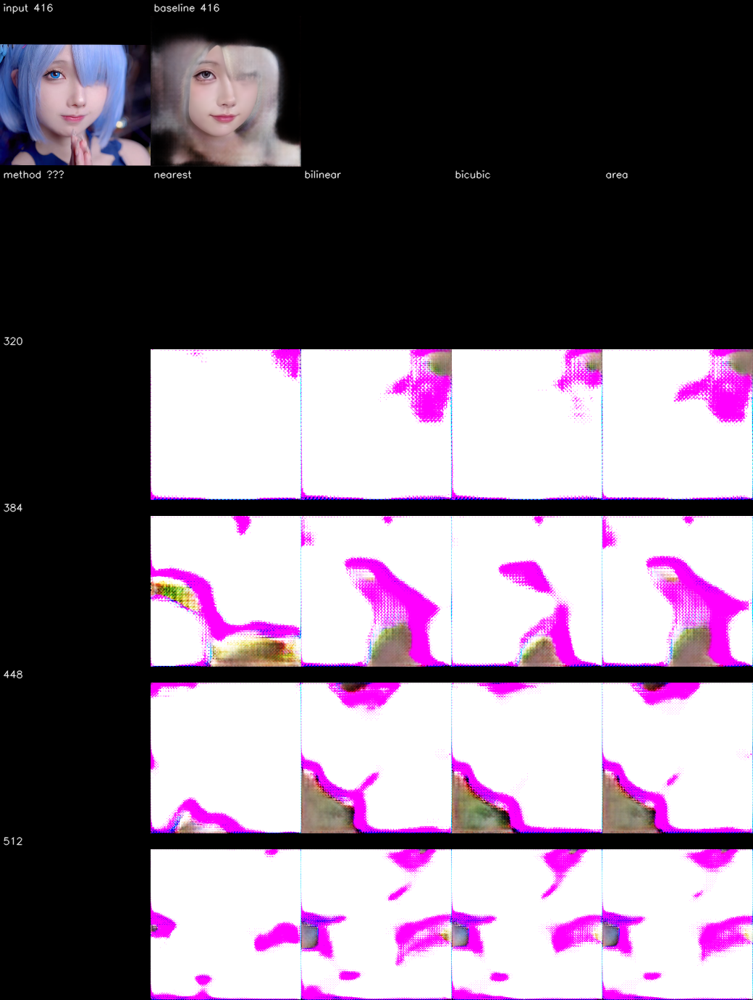

# Inter 权重换分辨率实验（df-udt @ 416）

模型：workspace/model/New416_SAEHD（df-udt, res=416, e_dims=80, ae_dims=320, iter 7,915,081）。
素材：app/docs/notes/target.jpg（**已对齐**，只做 resize）。前向：仓库自带 leras
（core.leras.archis.DeepFakeArchi, opts=udt），权重按 param_N.npy 顺序灌入；参数量与
New416_SAEHD_summary.txt 完全一致：encoder 24,457,280 / inter 51,971,200 / decoder(含 mask) 53,386,207。
预处理实测为 **BGR + [0,1]**。

## 一、最重要的结论：插值换 inter 不能保持行为

把 416 的 encoder 特征按目标网格缩放，分别喂「原 inter」与「换分辨率后的 inter」，
比 320 维潜码（插值回 13×13 再比）：

| 目标 | 方法 | latent MAE | cosine |
|---|---|---|---|
| 320 | nearest | 32.94 | -0.003 |
| 320 | bilinear | 17.73 | -0.001 |
| 320 | bicubic | 24.17 | -0.004 |
| 320 | **area** | **13.16** | 0.005 |
| 384 | nearest | 35.23 | -0.008 |
| 384 | bilinear | 13.83 | 0.005 |
| 384 | **area** | **13.48** | 0.005 |
| 448 | nearest | 44.28 | -0.009 |
| 448 | **bilinear** | **21.95** | 0.007 |
| 448 | area | 22.60 | 0.007 |
| 512 | nearest | 46.16 | -0.006 |
| 512 | **bilinear** | **30.87** | -0.004 |
| 512 | area | 33.74 | -0.004 |

cosine 全部落在 ±0.01 内 —— 换完的 inter 输出与原输出**几乎不相关**。
原因：dense1 每一行是独立系数，插值按空间相邻把它们混合了；低频骨架还在，映射关系没了。
所以：换分辨率 = 热启动，不是等价变换；换完必须续训（优化器状态形状不兼容会被删，动量归零）。

## 二、端到端（转换后直接推理，不续训）

| 目标 | 方法 | PSNR | SSIM | MAE |
|---|---|---|---|---|
| 320 | nearest | 3.44 | 0.432 | 154.4 |
| 320 | bilinear | 3.69 | 0.392 | 149.7 |
| 320 | bicubic | 3.56 | 0.413 | 152.1 |
| 320 | area | 3.66 | 0.390 | 150.4 |
| 384 | nearest | 3.55 | 0.304 | 149.3 |
| 384 | bilinear | 3.41 | 0.326 | 152.9 |
| 384 | bicubic | 3.36 | 0.349 | 155.2 |
| 384 | area | 3.44 | 0.317 | 152.2 |
| 448 | nearest | 3.48 | 0.411 | 153.2 |
| 448 | bilinear | 4.19 | 0.393 | 137.5 |
| 448 | bicubic | 4.01 | 0.396 | 141.2 |
| 448 | area | 4.14 | 0.400 | 138.7 |
| 512 | nearest | 3.48 | 0.409 | 153.1 |
| 512 | bilinear | 3.69 | 0.345 | 148.2 |
| 512 | bicubic | 3.66 | 0.364 | 148.9 |
| 512 | area | 3.66 | 0.358 | 148.8 |

这就是「不准续训会怎样」：输出整体漂移（矩阵图里饱和成紫白），所以 PSNR 只有 3~4 dB；
SSIM 0.3~0.43 只是结构偶然重合，不能当质量读。

## 三、方法建议

- 转换结果只能当**热启动**；出片前必须续训（几百~几千 iter）。
- 非要选一种插值：潜空间 MAE 最低的是 **area**（320/384）与 **bilinear**（448/512）；
  **nearest 一律最差**（latent MAE 高 2~3 倍），不要用。
- 网格用错（把带 t 的模型按 res/16 解析）会直接形状不符 —— 后缀决定 enc/low 网格，必须按 archi 走。

## 四、形状与布局

| 分辨率 | low=res/32 | dense1 | dense2 | bias |
|---|---|---|---|---|
| 416 | 13 | (108160,320) | (320,54080) | (54080,) |
| 320 | 10 | (64000,320) | (320,32000) | (32000,) |
| 384 | 12 | (92160,320) | (320,46080) | (46080,) |
| 448 | 14 | (125440,320) | (320,62720) | (62720,) |
| 512 | 16 | (163840,320) | (320,81920) | (81920,) |

*.pth = zip 里的 param_N.npy（无 pickle）；Dense 存 (in,out)、Conv 存 OIHW；
dense1 的行按**通道优先 (c,h,w)** 展平（见 app/engine/models/Model_SAEHD/resize_inter.py）。

## 五、复现

     runtime\engine\python.exe app/tools/bench/inter_study_run.py      # 16 组端到端 + baseline
     runtime\engine\python.exe app/tools/bench/inter_study_visual.py   # 对照矩阵图
     runtime\engine\python.exe app/tools/bench/inter_latent_metric.py  # 潜空间指标

产物目录：app/docs/notes/inter_study/