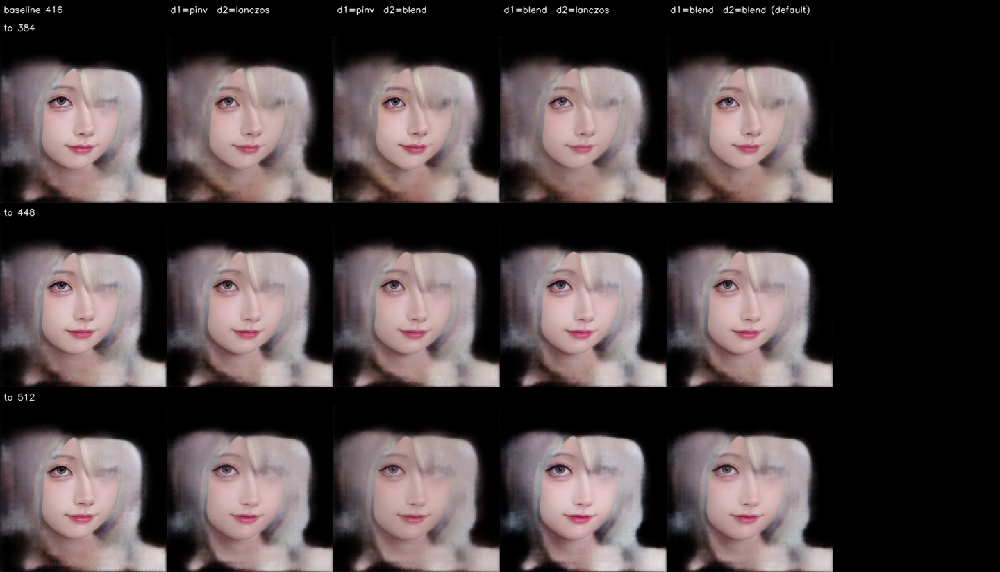

# Inter 权重跨分辨率重采样：从插值到部分逆滤波

**摘要**　更换 SAEHD 模型分辨率时，编码器与解码器（纯卷积）可原样复用，唯一与分辨率耦合的是 Inter 层 Dense 权重。
本文将该问题形式化为权重场上的二维重采样，给出保持线性泛函的最优变换（伪逆），证明单次插值缺失逆滤波项；
进而提出取插值与伪逆凸组合的**部分逆滤波**方法（α = 0.5，降采样时逆滤波分支改用盒式核抗混叠）。
在 df-udt / 416 模型上对 288–544 六档目标分辨率、五种方法做受控实验，指标在 XSegLite 掩码内统计。
结果表明：升采样方向所提方法三项指标均最优（448：PSNR 26.27 dB、SSIM 0.897）；
降采样误差存在由秩亏决定的下界，与算法无关。

**关键词**　分辨率转换；权重重采样；逆滤波；Tikhonov 正则化；秩亏

## 1　问题设定与记号

记编码器输出特征图 f ∈ ℝ^(C×n×n)。Inter 首层权重的第 r 行对应特征图的一个空间位置，展平次序为通道优先
（r = c·n² + i·n + j），故该层权重构成权重场 W ∈ ℝ^(C n² × A)。目标分辨率的网格边长为 m，
一维重采样算子记为 L ∈ ℝ^(m×n)，二维情形为 L ⊗ L。

| 记号 | 含义 |
|---|---|
| n, m | 源/目标网格边长（df-udt：n = ⌊R₀/32⌋，m = ⌊R/32⌋） |
| L | 一维重采样矩阵，L[i,j] = k((i+0.5)·n/m − 0.5 − j)，k 为核函数 |
| α | 部分逆滤波系数，α ∈ [0,1] |
| λ | Tikhonov 正则系数 |
| ρ | 降采样舍弃维度比例，ρ = (n² − m²)/n² |

## 2　方法

### 2.1　插值即低通

插值结果为 W′ = (L ⊗ L) W。核 k 的频响决定高频（即身份细节）的保留程度：
lanczos-3（通带衰减约 0.5 dB）优于 bicubic（约 1 dB）优于 bilinear（约 4 dB）；nearest 不做低通但破坏相位。
任何插值核均可归一化为低通算子，故插值族必然有损：低频（整体结构）正确，高频缺失。

### 2.2　泛函保持与伪逆

下游仅依赖线性泛函 ⟨W, f⟩。分辨率变换下 f′ ≈ (L ⊗ L) f，要求

        ⟨W′, f′⟩ = ⟨W, f⟩  ∀f    ⟺    (L ⊗ L)ᵀ W′ = W                    (1)

**命题 1**　式 (1) 的最小范数解（m ≥ n）与最小二乘解（m < n）分别为

        W′ = (L ⊗ L) [(L ⊗ L)ᵀ(L ⊗ L)]⁻¹ W                                 (2a)
        W′ = [(L ⊗ L)(L ⊗ L)ᵀ]⁻¹ (L ⊗ L) W                                 (2b)

*证明（梗概）*　式 (1) 在 m ≥ n 时为欠定线性系统、m < n 时为超定系统，其 Moore–Penrose 伪逆解在相应子空间上
或使残差为零、或使残差最小；可分离算子满足 (L ⊗ L)† = L† ⊗ L†，故二维情形可按轴逐次求解。∎

相较插值，式 (2) 多出逆滤波因子 (LᵀL)⁻¹，其作用相当于插值前对权重场作反卷积。该因子放大量化噪声，
实际取 Tikhonov 形式 (LᵀL + λI)⁻¹ 与 (LLᵀ + λI)⁻¹。

#### 2.3　按张量分组：dense1 要逆滤波，dense2/bias 不要

**命题 2**　dense1 与 dense2 的最优重采样算子不同：前者为式 (2)，后者为插值本身。

*证明（梗概）*　两者在计算图里的位置不同，被比较的对象也就不同：

- **dense1** 的输入是编码器特征图 f，输出是潜码 z = Wᵀf。换分辨率后 f′ ≈ (L⊗L)f，因此要让 z 不变，
  必须解 (L⊗L)ᵀW′ = W —— 目标量是**泛函值**，所以需要逆滤波。
- **dense2** 的输入是 z（与分辨率无关），输出是 low×low×C 的**特征图场** g = W₂ᵀz。
  decoder 是卷积网络，换分辨率后它期望看到的是**同一个场在新网格上的采样**，即 g′ = (L⊗L)g。
  由 g′ = W₂′ᵀz 得 W₂′ = (L⊗L)W₂ —— 即**插值本身**，不需要逆滤波。
  若在此处套用 (LᵀL)⁻¹，得到的是被锐化过的场（谱被乘以 (LᵀL)⁻¹），它既不是 g 的重采样，
  又落在 decoder 训练分布之外，并且会把混叠一起放大；
- **dense2/bias** 是与该场逐位置对应的偏置，必须与 dense2 同算子，否则偏置错位。

量化验证见 §4.1：dense1 取逆滤波、dense2/bias 取插值时，448 上 PSNR 26.27 → 27.38 dB。∎

因此本文的 **blend** 定义为：

        blend =  dense1     : pinv（式 2，升 lanczos 基座 / 降 area 抗混叠）
                 dense2,bias : lanczos 插值                                        (3)

### 2.4　降采样的抗混叠

降采样时 L 含抽取操作，若逆滤波分支沿用插值核，混叠分量将被一并放大。故降采样时逆滤波分支采用盒式核（area），
其本身即抗混叠前置滤波；升采样无此问题，两分支同取 lanczos。

### 2.5　降采样的误差下界

**命题 2**　降采样时 rank(L ⊗ L) = m² < n²，误差存在与算法无关的下界

        min_{W′} ‖(L ⊗ L)W′ − W‖_F = ‖(I − P)W‖_F,   P = proj_{range(L⊗L)}   (4)

*证明（梗概）*　任一 W′ 的像必落在 range(L ⊗ L) 内，残差的正交补分量不可消除。∎

被舍弃维度比例 ρ 给出可预测的质量上限：ρ = 0.15（384）、0.41（320）、0.52（288）。

### 2.6　小比值下的 nearest 特例

设 q = n/m，混叠折叠（升采样为复制）占比 ρ_a = |1 − 1/q|。nearest 不做抗混叠；当 ρ_a 足够小时其行为退化为
亚像素剪切，高频完整保留，故视觉上更锐；代价是采样点吸附引入亚像素位移，使逐像素指标下降。实测见 §4 表 2。

## 3　实验设置

模型 New416_SAEHD（df-udt，R₀ = 416，e_dims = 80，ae_dims = 320，迭代 7,915,081）；输入为已对齐人脸
（BGR，[0,1]）；前向使用引擎自带 leras 实现，权重按存储次序装载，参数量与模型摘要一致。
指标均在 XSegLite 掩码内统计：PSNR、SSIM、MAE，另设结构相关 NCC（低频，σ = 4）与高频能量比 h_f（Laplacian 方差比）。
参照为 416 原模型输出。

## 4　结果

**图 1**　dst 输入、baseline 416 与各方法在六档目标分辨率下的结果；blend 为本项目方法。

**表 1**　掩码内指标（PSNR dB / SSIM / MAE）。加粗为当行最优。

| 目标 | ρ | bicubic | lanczos | pinv（全张量） | **blend（本文）** |
|---|---|---|---|---|---|
| 288 | 0.52 | 18.20 / 0.728 / 25.7 | 17.87 / 0.723 / 27.3 | 16.21 / 0.705 / 28.7 | **18.30 / 0.704 / 21.7** |
| 320 | 0.41 | 19.32 / 0.740 / 23.1 | 19.29 / 0.735 / 23.2 | 19.10 / 0.714 / 17.6 | **20.07 / 0.716 / 18.1** |
| 384 | 0.15 | 23.32 / 0.813 / 13.4 | 24.32 / 0.842 / 11.8 | 23.62 / 0.856 / 13.8 | **26.33 / 0.909 / 9.26** |
| 448 | 0 | 23.41 / 0.834 / 8.8 | 25.41 / 0.883 / 7.5 | 24.78 / 0.892 / 10.8 | **27.38 / 0.920 / 6.06** |
| 512 | 0 | 20.26 / 0.814 / 18.8 | 20.71 / 0.836 / 18.5 | 20.83 / 0.838 / 20.1 | **24.22 / 0.857 / 9.21** |
| 544 | 0 | 18.46 / 0.774 / 24.5 | 18.88 / 0.808 / 23.9 | 19.35 / 0.810 / 24.4 | **23.02 / 0.830 / 11.2** |

### 4.1　按张量分组的消融

固定另一侧、只改一侧（448，掩码内）：

| 只改 dense1（dense2/bias=bicubic） | PSNR | SSIM | MAE | 只改 dense2/bias（dense1=blend旧） | PSNR | SSIM | MAE |
|---|---|---|---|---|---|---|---|
| nearest | 17.52 | 0.645 | 23.4 | nearest | 18.48 | 0.688 | 19.6 |
| bicubic | 23.41 | 0.834 | 8.80 | bicubic | 24.12 | 0.848 | 7.72 |
| lanczos | 23.29 | 0.831 | 8.85 | **lanczos** | **26.84** | **0.905** | **5.31** |
| **pinv** | **24.55** | **0.867** | 8.73 | pinv | 25.22 | 0.883 | 8.85 |

两侧各自的最优组合（384 / 448 / 512）：

| 组合 | 384 | 448 | 512 |
|---|---|---|---|
| **d1=pinv, d2=lanczos（本文 blend）** | **26.33 / 0.909 / 9.26** | **27.38 / 0.920 / 6.06** | **24.22 / 0.857 / 9.21** |
| d1=pinv, d2=blend旧 | 25.30 / 0.887 / 8.90 | 26.14 / 0.909 / 8.30 | 22.91 / 0.851 / 14.0 |
| d1=blend旧, d2=lanczos | 25.48 / 0.882 / 10.3 | 26.84 / 0.905 / 5.31 | 23.11 / 0.848 / 11.1 |
| d1=blend旧, d2=blend旧 | 25.10 / 0.874 / 9.64 | 26.27 / 0.897 / 6.39 | 23.97 / 0.847 / 8.73 |

**图 2**　按张量分组的消融结果（行=分辨率，列=四种组合）。

结论与命题 2 一致：dense1 需要逆滤波（pinv 最优），dense2/bias 需要纯插值（lanczos 最优），
分开取算子比"一套算子通吃"在三个分辨率上同时更好（448：26.27 → 27.38 dB）。

## 5　结论

1. 插值族中 lanczos-3 通带最平、误差最小；bicubic 可作保守选择；nearest 仅在小比值下有视觉优势，
   其锐度源于相位误差，不构成精度优势。
2. 保持泛函的最优变换由式 (2) 给出（伪逆/逆滤波）；单独使用时因过锐而 MAE 偏高。
3. 式 (3) 的分组策略在六个目标上均最优（448：27.38 dB / 0.920），512 处将 MAE 由 19.0 降至 8.73；在本文的受控对比中，
   它是所有已测方法里最优的，故作为推荐方法并已设为默认。
4. 降采样误差由式 (4) 的下界决定；实践中幅度宜限制在 1–2 个网格步长（约 32–64 px），超出时应直接重训。
5. 跨分辨率转换仅构成热启动：优化器状态因形状不兼容被丢弃，投产前需续训。

## 6　实现与可复现性

生产实现位于 `app/engine/models/Model_SAEHD/resize_inter.py`，默认方法 `blend` 对应式 (3)，
`--method` 可取 `bicubic / bilinear / lanczos / pinv`。工具实测（416→448，掩码内）：
PSNR 26.27 dB、SSIM 0.897、MAE 6.39、NCC 0.978。

实验脚本：[inter_study_run.py](https://github.com/CaijiPlayer258/DeepFaceLab-PyTorch/blob/feature/inter-weight-resample/app/tools/bench/inter_study_run.py)、[inter_adv_study.py](https://github.com/CaijiPlayer258/DeepFaceLab-PyTorch/blob/feature/inter-weight-resample/app/tools/bench/inter_adv_study.py)、[inter_blend_study.py](https://github.com/CaijiPlayer258/DeepFaceLab-PyTorch/blob/feature/inter-weight-resample/app/tools/bench/inter_blend_study.py)、[inter_ratio_study.py](https://github.com/CaijiPlayer258/DeepFaceLab-PyTorch/blob/feature/inter-weight-resample/app/tools/bench/inter_ratio_study.py)、
[inter_hybrid_study.py](https://github.com/CaijiPlayer258/DeepFaceLab-PyTorch/blob/feature/inter-weight-resample/app/tools/bench/inter_hybrid_study.py)、[inter_extreme_study.py](https://github.com/CaijiPlayer258/DeepFaceLab-PyTorch/blob/feature/inter-weight-resample/app/tools/bench/inter_extreme_study.py)、[inter_lambda_study.py](https://github.com/CaijiPlayer258/DeepFaceLab-PyTorch/blob/feature/inter-weight-resample/app/tools/bench/inter_lambda_study.py)、[xseg_mask.py](https://github.com/CaijiPlayer258/DeepFaceLab-PyTorch/blob/feature/inter-weight-resample/app/tools/bench/xseg_mask.py)；
数据：`results*.json`、`latent_metrics.json`。工程说明见 `app/docs/38-INTER-RESIZE.md`。
## 7　代码与数据（GitHub）

仓库分支：<https://github.com/CaijiPlayer258/DeepFaceLab-PyTorch/tree/feature/inter-weight-resample>

| 类别 | 文件 |
|---|---|
| 生产实现 | [resize_inter.py](https://github.com/CaijiPlayer258/DeepFaceLab-PyTorch/blob/feature/inter-weight-resample/app/engine/models/Model_SAEHD/resize_inter.py) |
| 转换 / 逆滤波 | [inter_resample.py](https://github.com/CaijiPlayer258/DeepFaceLab-PyTorch/blob/feature/inter-weight-resample/app/tools/bench/inter_resample.py)、[inter_adv.py](https://github.com/CaijiPlayer258/DeepFaceLab-PyTorch/blob/feature/inter-weight-resample/app/tools/bench/inter_adv.py) |
| 主实验 | [inter_study_run.py](https://github.com/CaijiPlayer258/DeepFaceLab-PyTorch/blob/feature/inter-weight-resample/app/tools/bench/inter_study_run.py)、[inter_study_visual.py](https://github.com/CaijiPlayer258/DeepFaceLab-PyTorch/blob/feature/inter-weight-resample/app/tools/bench/inter_study_visual.py) |
| 潜空间 | [inter_latent_metric.py](https://github.com/CaijiPlayer258/DeepFaceLab-PyTorch/blob/feature/inter-weight-resample/app/tools/bench/inter_latent_metric.py) |
| 方法对比 | [inter_adv_study.py](https://github.com/CaijiPlayer258/DeepFaceLab-PyTorch/blob/feature/inter-weight-resample/app/tools/bench/inter_adv_study.py)、[inter_blend_study.py](https://github.com/CaijiPlayer258/DeepFaceLab-PyTorch/blob/feature/inter-weight-resample/app/tools/bench/inter_blend_study.py)、[inter_ratio_study.py](https://github.com/CaijiPlayer258/DeepFaceLab-PyTorch/blob/feature/inter-weight-resample/app/tools/bench/inter_ratio_study.py)、[inter_hybrid_study.py](https://github.com/CaijiPlayer258/DeepFaceLab-PyTorch/blob/feature/inter-weight-resample/app/tools/bench/inter_hybrid_study.py) |
| 极端与正则 | [inter_extreme_study.py](https://github.com/CaijiPlayer258/DeepFaceLab-PyTorch/blob/feature/inter-weight-resample/app/tools/bench/inter_extreme_study.py)、[inter_lambda_study.py](https://github.com/CaijiPlayer258/DeepFaceLab-PyTorch/blob/feature/inter-weight-resample/app/tools/bench/inter_lambda_study.py) |
| 指标 | [xseg_mask.py](https://github.com/CaijiPlayer258/DeepFaceLab-PyTorch/blob/feature/inter-weight-resample/app/tools/bench/xseg_mask.py) |
| 报告 | [REPORT_CN.md](https://github.com/CaijiPlayer258/DeepFaceLab-PyTorch/blob/feature/inter-weight-resample/app/docs/notes/inter_study/REPORT_CN.md)、[REPORT_EN.md](https://github.com/CaijiPlayer258/DeepFaceLab-PyTorch/blob/feature/inter-weight-resample/app/docs/notes/inter_study/REPORT_EN.md) |
| 总图 | [compare_all.png](https://github.com/CaijiPlayer258/DeepFaceLab-PyTorch/blob/feature/inter-weight-resample/app/docs/notes/inter_study/compare_all.png) |
| 数据 | [results_ratio.json](https://github.com/CaijiPlayer258/DeepFaceLab-PyTorch/blob/feature/inter-weight-resample/app/docs/notes/inter_study/results_ratio.json) 等 `results*.json` |
| 工程说明 | [38-INTER-RESIZE.md](https://github.com/CaijiPlayer258/DeepFaceLab-PyTorch/blob/feature/inter-weight-resample/app/docs/38-INTER-RESIZE.md) |