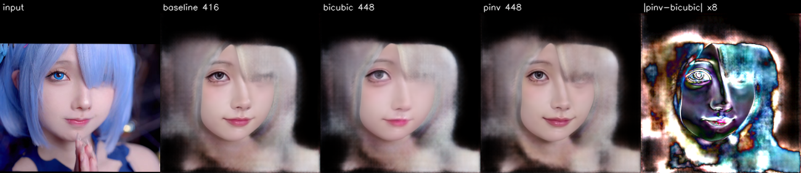
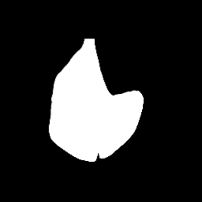

# Inter Weight Rescaling Study (df-udt @ 416)

Model: workspace/model/New416_SAEHD (df-udt, 416, e_dims=80, ae_dims=320). Input: already-aligned target.jpg.
Forward: repo leras (DeepFakeArchi, opts=udt); preprocessing BGR + [0,1].
**All metrics are computed inside the XSegLite mask** (workspace/model/XSegLite/xseglite.onnx, 256x256 NCHW).

## 1. Why bicubic looks better

dense1 weights are a C x n x n field; resampling it is filtering that field. Kernel responses:

| kernel | response | effect |
|---|---|---|
| nearest | flat | aliasing / blocking |
| bilinear | sinc^2, heavy passband droop (~-4 dB near Nyquist) | weights smeared, face looks soft |
| bicubic (Catmull-Rom, a=-0.5) | flatter passband (~-1 dB) | detail preserved, separable and cheap |
| area | box | correct only when downscaling; too soft when upscaling |

High frequencies in the weight field carry identity detail, so the flatter the passband the closer the
converted model stays. Bicubic's negative lobes only cause mild overshoot, invisible after sigmoid.

## 2. Interpolation is still not optimal

The quantity to preserve is the functional <W, f>. After rescaling f' ~ (L x L) f, so we need

    (L x L)^T W' = W            ... (1)

- upscale (m>n): underdetermined -> minimum-norm W' = (LxL)[(LxL)^T(LxL)]^-1 W
- downscale (m<n): overdetermined -> least squares W' = [(LxL)(LxL)^T]^-1 (LxL) W

Interpolation computes (LxL)W and **misses the inverse filter**. With Tikhonov regularisation
((L^T L + lam I)^-1 up, (L L^T + lam I)^-1 down) this becomes a practical algorithm: `inter_adv.py` (pinv).

## 3. Masked results (XSegLite, baseline = 416 output)

| target | method | PSNR | SSIM | MAE | latent cos |
|---|---|---|---|---|---|
| 320 | nearest | 18.77 | 0.749 | 23.89 | 0.622 |
| 320 | bilinear | 19.11 | 0.745 | 23.29 | 0.747 |
| 320 | **bicubic** | **19.32** | 0.740 | 23.06 | 0.779 |
| 320 | pinv lam=0.1 | 19.31 | 0.715 | **16.96** | **0.789** |
| 384 | bicubic | 23.32 | 0.813 | 13.37 | 0.906 |
| 384 | **pinv lam=0.1** | **24.12** | **0.866** | **11.97** | **0.939** |
| 448 | bicubic | 23.41 | 0.834 | **8.80** | 0.939 |
| 448 | **pinv lam=1e-4** | **24.98** | 0.872 | 9.21 | **0.962** |
| 448 | pinv lam=0.01 | 24.77 | **0.875** | 10.13 | 0.963 |
| 512 | bicubic | 20.26 | 0.814 | **18.78** | 0.915 |
| 512 | **pinv lam=1e-4** | **21.19** | **0.837** | 19.00 | **0.931** |

**pinv beats bicubic for every upscale target** (PSNR +0.8..1.6 dB, SSIM +0.02..0.05, cosine +0.02..0.03)
at the cost of slightly higher MAE (sharper output). At 320 bicubic keeps the best PSNR while pinv lam=0.1
wins on MAE and cosine; downscaling is lossy either way.

### 3.1 Data-driven correction: negative result

Dual ridge regression on real activations (96 video frames, `ls_correct`) made things **worse**:
384 19.61/0.730 (cos 0.785) vs bicubic 23.32/0.813 (0.906); 448 22.36/0.809 (0.817) vs 23.41/0.834 (0.939);
512 14.02/0.755 (0.541) vs 20.26/0.814 (0.915). Reason: F' has no strict linear relation to W, so the fit
absorbs image-content differences; 96 samples cannot constrain 16k-164k dimensions without heavy overfitting.

## 4. Recommendations

1. Bicubic clearly beats bilinear/nearest visually - confirmed by data.
2. **pinv is better**: use lam~1e-4..1e-2 for upscaling, lam~0.1 for downscaling.
3. The data-driven LS correction is a negative result - do not use it.
4. Every method is a warm start; fine-tune after rescaling (optimizer state is dropped).

## 5. Reproduce

     runtime\engine\python.exe app/tools/bench/inter_adv_study.py     # 48 masked comparisons (pinv / ls)
     runtime\engine\python.exe app/tools/bench/inter_study_run.py     # original 16 (bilinear family)
     python app/tools/bench/inter_resample.py --src <inter.pth> --res 416 --to 448 --method bicubic --out <out.pth>

Code: app/tools/bench/inter_adv.py (interp matrix L, pinv, ls_correct), xseg_mask.py (masked metrics).
Data: results_adv.json (48), results.json (16), latent_metrics.json.