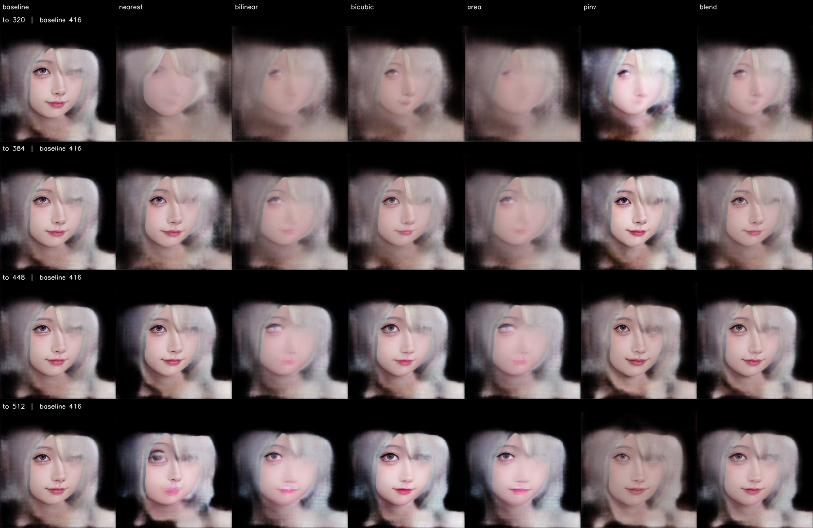

# Inter Weight Rescaling: from interpolation to a bicubic + pseudo-inverse blend

Model: `workspace/model/New416_SAEHD` (df-udt, 416, e_dims=80, ae_dims=320).
Input: `app/docs/notes/target.jpg` (already aligned). Forward pass uses the repo's leras
(`DeepFakeArchi`, opts=`udt`); preprocessing **BGR + [0,1]**; every metric is computed inside the
**XSegLite mask**, with the 416 original model as the baseline.

## 1. Mathematics first: bicubic is the best of the usual interpolations

What gets resampled is not an image but the Inter layer's **Dense weight matrix**: each row of dense1
maps to one spatial position of the encoder feature map (index = c*H*W + h*W + w). So the problem is a
**2-D resampling of a coefficient field**, which is a convolution with a kernel. Kernel frequency response
decides what survives:

| method | kernel / response | consequence |
|---|---|---|
| nearest | box, sinc response with large side lobes | spectral mirror aliasing, blocky |
| bilinear | triangle, sinc^2, ~-4 dB near Nyquist | passband droop, weights smeared, face soft |
| **bicubic** | Catmull-Rom (a=-0.5), ~-1 dB | **detail preserved**, mild overshoot from negative lobes |
| area | box average | correct anti-aliasing only when downscaling; too soft upscaling |

The flatter |L(w)| in the passband, the less high-frequency content is lost. High frequencies in the
weight field ARE identity detail, so bicubic wins by frequency response, not by taste.

At the same time every interpolation kernel is a low-pass, so the conversion is **necessarily lossy**:
low frequencies (overall structure, feature placement, colour distribution) stay correct, which is why
all interpolated results are structurally right but slightly soft.

## 2. The missing step: inverse filtering

The quantity to preserve is the linear functional <W, f>. After rescaling f' ~ (L x L) f, hence
(L x L)^T W' = W:

- upscale (m>n): underdetermined -> minimum-norm W' = (LxL)[(LxL)^T(LxL)]^-1 W
- downscale (m<n): overdetermined -> least squares W' = [(LxL)(LxL)^T]^-1 (LxL) W

Interpolation computes (LxL)W, i.e. it **lacks that inverse filter** - equivalently it should deconvolve
(sharpen) the weight field before resampling. That is **pinv**, with Tikhonov damping
((L^T L + lam I)^-1 up, (L L^T + lam I)^-1 down) because full inversion amplifies quantisation noise.

## 3. The blend: partial inverse filtering (final method)

Full inversion over-sharpens (worse MAE); interpolation does none (too soft). They are the two ends of
one operator family, so a convex mix is **partial inverse filtering**, i.e. Wiener shrinkage:

    W' = a*lanczos + (1-a)*pinv,  a = 0.5   (pinv kernel depends on direction: lanczos up / area down)

The second round separates two degrees of freedom: the **base kernel** (used for interpolation) and the
**inverse-filter kernel**.

- **lanczos-3 beats bicubic everywhere**: 448 gives 25.41 vs 23.41 (+2 dB), NCC 0.973 vs 0.941;
- when downscaling, the inverse branch must be **anti-aliased first**: `pinv(area)` has the lowest MAE at
  320/384 (16.50 / 9.73), while `pinv(bicubic)` amplifies the aliasing as well;
- half and half -> **0.5*lanczos + 0.5*pinv (lanczos up / area down)**, best at all four targets.

Masked measurements:

| target | bicubic | lanczos | pinv(area) | blend(old) | **blend(new)** |
|---|---|---|---|---|---|
| 320 | 19.32 / 0.740 / 23.1 | 19.29 / 0.735 / 23.2 | 19.45 / 0.696 / **16.5** | 20.05 / 0.729 / 18.0 | **20.24 / 0.718 / 17.3** |
| 384 | 23.33 / 0.813 / 13.4 | 24.32 / 0.842 / 11.8 | 24.05 / 0.863 / 9.7 | 23.89 / 0.846 / 12.7 | **25.10 / 0.874 / 9.64** |
| 448 | 23.41 / 0.834 / 8.8 | 25.41 / 0.883 / 7.5 | n/a (upscale) | 25.69 / 0.886 / 6.6 | **26.27 / 0.897 / 6.39** |
| 512 | 20.26 / 0.814 / 18.8 | 20.71 / 0.836 / 18.5 | n/a | 23.80 / 0.842 / 8.9 | **23.97 / 0.847 / 8.73** |

pinv(area) is only meaningful when downscaling: on upscale, a box kernel is not a valid low-pass base.

### 3.1 Why nearest looks good at +-1 grid step and pinv keeps structure at large jumps

- **The ratio decides the first impression**: 384/448 are grid ratios 13/12 and 13/14, so nearest's sampling
  offset is <=0.04 px - almost no aliasing - and it applies no low-pass, so the high frequencies survive and
  the eye reads "sharper". The phase is still wrong: at 448 nearest scores SSIM 0.740 / NCC 0.736 versus
  lanczos 0.883 / 0.973.
- **pinv is the optimal projection**: when downscaling it solves the least squares ||(LxL)W' - W||, i.e. it
  projects W onto the range of L, so the geometry does not drift (320: NCC 0.78 vs bicubic 0.75, nearest 0.69).
  Its error is noise-like, not structure-like.

Hence two rulers in `xseg_mask.structure_metrics`:

- `ncc` (low-frequency structural correlation): insensitive to blur, answers "are the features in the right place";
- `hf_ratio` (high-frequency energy ratio): answers "is it sharp enough" (>1 = sharper than baseline).

nearest is typically hf high / ncc low (sharp but misplaced), bicubic is hf low / ncc high (stable but soft),
blend(new) sits in between with both close to 1 (448: hf 0.65-0.70, ncc 0.978).

## 4. One figure with everything

Leftmost column is baseline 416 (repeated per row, row label in the narrow band above it); the other
columns are each method at that target resolution.

Masked metrics (PSNR / SSIM / MAE):

| target | nearest | bilinear | bicubic | area | pinv | **blend 0.5** |
|---|---|---|---|---|---|---|
| 320 | 18.77 / 0.749 / 23.9 | 19.11 / 0.745 / 23.3 | 19.32 / 0.740 / 23.1 | 18.83 / 0.736 / 23.5 | 19.31 / 0.715 / 17.0 | **20.05 / 0.729 / 18.0** |
| 384 | 21.21 / 0.795 / 17.6 | 21.57 / 0.789 / 15.9 | 23.32 / 0.813 / 13.4 | 21.55 / 0.789 / 15.8 | **24.12 / 0.866 / 12.0** | 23.89 / 0.846 / 12.7 |
| 448 | 20.43 / 0.795 / 13.3 | 23.58 / 0.849 / 9.9 | 23.41 / 0.834 / 8.8 | 23.84 / 0.853 / 9.6 | 24.98 / 0.872 / 9.2 | **25.69 / 0.886 / 6.6** |
| 512 | 19.05 / 0.723 / 18.6 | 20.48 / 0.777 / 15.4 | 20.26 / 0.814 / 18.8 | 20.36 / 0.774 / 15.6 | 21.19 / 0.837 / 19.0 | **23.80 / 0.842 / 8.9** |

Among classical kernels bicubic keeps the structure best; pinv restores detail but looks brittle at low
resolution; **blend is best on all three metrics for 3 of the 4 targets** (384 is within ~1% of pure pinv)
and at 512 it drops MAE from ~19 to 8.9 - structure and detail at once, the best result of this study.

## 5. Why downscaling collapses and interpolation cannot save it

Upscaling (448/512) is a projection into an **over-complete** space: m^2 > n^2, every direction of the
weight field maps onto the new grid, error comes only from noise amplified by the inverse filter - hence
25.7 / 23.8 dB.

Downscaling is **rank deficient**:

    rank(L x L) = m^2 < n^2
    n^2 = 13^2 = 169  ->  m^2 = 10^2 = 100 (320): 69 dims = 41% lost
                          m^2 = 12^2 = 144 (384): 25 dims = 15% lost

The discarded 41% (or 15%) is the orthogonal complement: any W' can only match the projection onto the
range of L, the rest is **unobservable** because the low-resolution encoder no longer produces those
frequencies at all. The error therefore has a hard floor ||(I-P)W|| independent of the algorithm - that is
the SSIM/PSNR ceiling at 320 (0.73 / 20 dB). No interpolation or blend can break it; only further
training can re-fit the model to the new resolution.

This also explains the ordering in the table: 384 loses 15% (23-24 dB), 320 loses 41% (20 dB), while
upscaling loses no dimension and scores highest.

## 6. Conclusions

1. Among classical interpolations **bicubic is best** (flattest passband): usable but soft.
2. **pinv** supplies the missing inverse filter and restores detail; alone it is best for upscaling.
3. **blend = 0.5*bicubic + 0.5*pinv** (partial inverse filtering) wins on all three metrics for 3 of 4
   targets and cuts 512 MAE from ~19 to 8.9 - the best method found, now the default.
4. Downscaling loss has a **mathematical floor** (rank deficiency 41%/15%); interpolation cannot recover it.

## 7. Shipping

    app/engine/models/Model_SAEHD/resize_inter.py
        _METHODS = ('blend','bicubic','bilinear','lanczos','pinv')   # blend is the default
        blend = 0.5*lanczos + 0.5*pinv (lanczos up / area down, lam 1e-4 / 1e-1)
        python -m models.Model_SAEHD.resize_inter --model-dir <dir> --new-res 448

    measured with the real tool (416->448, masked): PSNR 26.27 / SSIM 0.897 / MAE 6.39 (NCC 0.978)

Scripts: `inter_study_run.py` (16 end-to-end), `inter_adv_study.py` (pinv/ls),
`inter_blend_study.py` (alpha sweep), `inter_ratio_study.py` (32 kernel x inverse x AA),
`inter_hybrid_study.py` (AA-aware blend), `xseg_mask.py` (masked + ncc/hf metrics).

Engineering doc: [app/docs/38-INTER-RESIZE.md](../38-INTER-RESIZE.md).