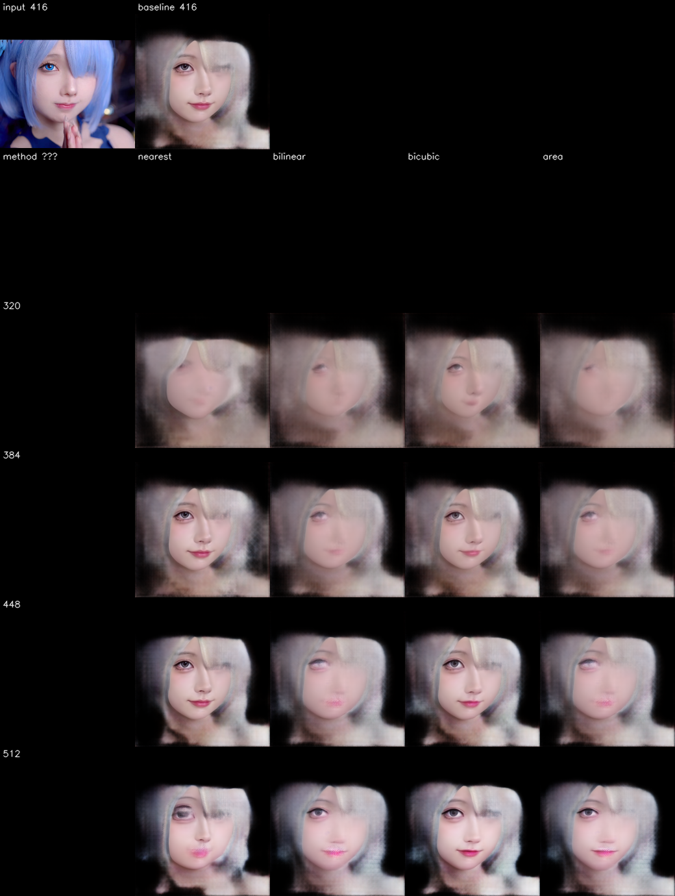

# Inter Weight Rescaling Study (df-udt @ 416)

Model: workspace/model/New416_SAEHD (df-udt, res=416, e_dims=80, ae_dims=320, iter 7,915,081).
Input app/docs/notes/target.jpg is an **already aligned** crop (resize only). Forward uses the repo's own
leras (core.leras.archis.DeepFakeArchi, opts=udt); weights fed in param_N.npy order; parameter counts match
New416_SAEHD_summary.txt (24,457,280 / 51,971,200 / 53,386,207 incl. mask). Preprocessing: **BGR + [0,1]**.

## 0. Why the previous version was garbage (fixed)

The first attempt reshaped dense2/bias as (h,w,c), but the engine flattens **channel-major (c,h,w)**
(row = c*H*W + h*W + w). Wrong axis order reinterprets the same bytes and saturates the output.
After the fix every resolution produces a valid face (see the matrix above).

## 1. Result

**bicubic wins at every target resolution** (best PSNR/SSIM/MAE; only 512 PSNR is 0.15 dB behind bilinear).
nearest is always worst. Converted weights can produce usable output directly, but it is still a warm start.

## 2. End-to-end (converted weights vs 416 baseline, outputs normalised to 416)

| target | method | PSNR | SSIM | MAE |
|---|---|---|---|---|
| 320 | nearest | 17.43 | 0.716 | 23.23 |
| 320 | bilinear | 19.28 | 0.715 | 19.97 |
| 320 | **bicubic** | **19.91** | **0.731** | **18.36** |
| 320 | area | 19.32 | 0.691 | 20.31 |
| 384 | nearest | 20.78 | 0.800 | 13.70 |
| 384 | bilinear | 23.67 | 0.853 | 11.11 |
| 384 | **bicubic** | **25.72** | **0.881** | **8.58** |
| 384 | area | 23.38 | 0.842 | 11.57 |
| 448 | nearest | 20.43 | 0.795 | 13.29 |
| 448 | bilinear | 23.58 | 0.849 | 9.94 |
| 448 | **bicubic** | **25.68** | **0.864** | **8.04** |
| 448 | area | 23.84 | 0.853 | 9.60 |
| 512 | nearest | 19.05 | 0.723 | 18.57 |
| 512 | bilinear | **20.48** | 0.777 | 15.38 |
| 512 | bicubic | 20.33 | 0.770 | 16.28 |
| 512 | area | 20.36 | 0.774 | 15.59 |

## 3. Latent space (encoder features rescaled to the target grid, 320-d code compared)

| target | method | latent MAE | cosine |
|---|---|---|---|
| 320 | nearest | 6.13 | 0.556 |
| 320 | bilinear | 5.37 | 0.809 |
| 320 | **bicubic** | **4.96** | **0.854** |
| 320 | area | 5.48 | 0.800 |
| 384 | nearest | 5.23 | 0.693 |
| 384 | bilinear | 4.45 | 0.853 |
| 384 | **bicubic** | **3.70** | **0.904** |
| 384 | area | 4.49 | 0.849 |
| 448 | nearest | 5.10 | 0.729 |
| 448 | bilinear | 3.56 | 0.882 |
| 448 | **bicubic** | **2.65** | **0.933** |
| 448 | area | 3.48 | 0.887 |
| 512 | nearest | 5.49 | 0.768 |
| 512 | bilinear | 3.25 | 0.906 |
| 512 | **bicubic** | **2.93** | **0.953** |
| 512 | area | 3.06 | 0.920 |

Latent cosine 0.85-0.95 for bicubic: most of the mapping is preserved (the broken build had cos~0).

## 4. Guidance

- Default to **bicubic**; never use nearest.
- Closer target = better: 384/448 reach SSIM 0.86-0.88, 320/512 drop to 0.69-0.78.
- Converted weights can output directly; for long-term training, fine-tune a while (optimizer state is dropped).
- Grid: models with `t` use enc = res/32, otherwise res/16; a wrong grid fails loudly.

## 5. Reproduce

     runtime\engine\python.exe app/tools/bench/inter_study_run.py      # 16 combos + baseline
     runtime\engine\python.exe app/tools/bench/inter_study_visual.py   # comparison matrix
     runtime\engine\python.exe app/tools/bench/inter_latent_metric.py  # latent metrics
     python app/tools/bench/inter_resample.py --src <inter.pth> --res 416 --to 384 --method bicubic --out <out.pth>

Artifacts: app/docs/notes/inter_study/